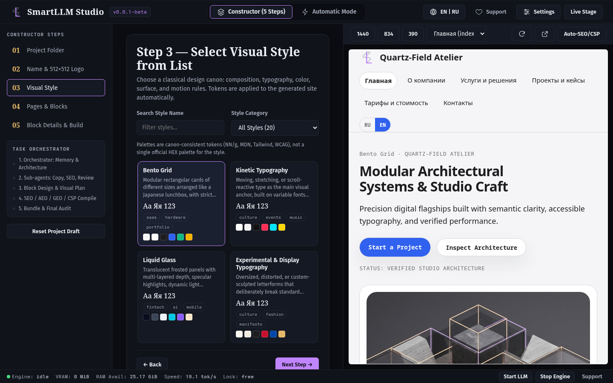

<p align="center">
  
</p>

<h1 align="center">SmartLLM &amp; SmartLLM Studio <code>v0.0.1-beta</code></h1>

<p align="center">
  <b>Local Offline Multimodal Website, Design &amp; Copywriting Combine (EN + RU)</b><br>
  Zero Cloud Calls · Zero Disk Swap · Deterministic SHA-256 CSP &amp; SEO/GEO Compiler
</p>

<p align="center">
  <b>English</b> | <a href="README.ru.md">Русский</a>
</p>

<p align="center">
  
  
  
  
</p>

---

## Live Studio UI & Real Generated Sites

<p align="center">
  
  <br><sub><b>SmartLLM Studio</b> (`127.0.0.1:8090`): 5-Step Constructor + Automatic Mode, 20 classical design canons with OKLCH tokens, persistent Live Stage (`1440 / 834 / 390`), and live GPU/RAM telemetry HUD.</sub>
</p>

<table>
  <tr>
    <td align="center" width="50%">
      <br>
      <sub><b>01 · Aether Compute</b> — Automatic Mode (`EN`) · <code>Bento Grid</code> · 8 pages · Review <b>6.0/6</b> · <a href="studio/examples/01_auto_en_aether_compute.md">Prompt</a></sub>
    </td>
    <td align="center" width="50%">
      <br>
      <sub><b>02 · Северный Контур</b> — Automatic Mode (`RU`) · <code>Visual Storytelling</code> · 7 pages · Review <b>6.0/6</b> · <a href="studio/examples/02_auto_ru_sever_arch.md">Prompt</a></sub>
    </td>
  </tr>
  <tr>
    <td align="center" width="50%">
      <br>
      <sub><b>03 · Kuro Specialty Roasters</b> — 5-Step Constructor (`EN`) · <code>Micro-Interactions &amp; Tactile UI</code> · 4 pages · Review <b>6.0/6</b> · <a href="studio/examples/03_ctor_en_kuro_roasters.md">Guide</a></sub>
    </td>
    <td align="center" width="50%">
      <br>
      <sub><b>Z-Image 3:4 Portraits (<code>576×768</code>)</b> — Gender-matched prompts with guaranteed vertical headroom and <code>object-position: 50% 15%</code> framing.</sub>
    </td>
  </tr>
</table>

---

## Verified Numbers (`RTX 4080 Laptop 12 GB VRAM` + `32 GiB RAM`)

| Metric | Measured Result | Scope / Source |
|---|---|---|
| **Production Checkpoint** | **`55.01 GiB`** (`K=320/512`, `IQ3_XXS + GSQ Q2_0`) | Pruned & healed from `Qwen/Qwen3.8-Flash-Next` (`335.30 GiB` BF16) |
| **Quantization Accuracy** | **`-65.68%`** `ffn_down_exps` L2 error vs stock `Q2_0` | `931/931` CUDA `test-backend-ops` PASS |
| **Decode Throughput** | **`21.14 tok/s`** mean (`17.502 tok/s` 20m 32K soak) | `59` EN+RU requests up to `18,777` tok/seq |
| **Zero-Swap Memory** | **`0 B`** disk swap · **`0 kB`** resident PLE RSS | `26.82 GiB` PLE via direct `O_DIRECT` NVMe `pread`; `max VRAM = 9.12 GiB` |
| **Web Lighthouse (Suite / Holdout)** | **`100 / 98.2 / 95.6 / 97.6`** · **`100 / 98.8 / 95.2 / 98.0`** | Real Chromium + Lighthouse (`P / A / BP / SEO`, `0` unsafe-inline) |
| **Strict TypeScript** | **`10/10`** Suite + **`8/8`** Holdout unit tests PASS | Compiled with `tsc --strict` (`0` `any`) |
| **Studio UI Gate** | **`227/227`** controls bound · LH **`100 / 100`** | `0` console errors, `0` external requests, `54` responsive shots |

---

## How the Combine Works

```text
User Prompt (EN / RU / EN+RU)
  ├─► Automatic Mode (10-stage Sub-Agent Pipeline over disk memory `smartllm.md` + `.smartllm/state.json`)
  │     foundation (single source of truth) ─► architect (page quests) ─► structure ─► hero ─► copy ─► seo ─► visuals ─► localize ─► review (6/6)
  ├─► GPU Sequential Handoff (`llama-server` -> 0 MiB VRAM -> `sd-cli` Z-Image-Turbo -> 0 MiB VRAM)
  │     • 6× Logo Generator (512×512) & auto brand-logo.png
  │     • Layout-matched heroes/gallery + vertical 3:4 (576×768) gender-locked team portraits
  └─► Deterministic Compiler (HTML5 + OKLCH `tokens.css` + SHA-256 CSP + JSON-LD `@graph` + `_headers` + `llms.txt` + `sitemap.xml`)
```

---

## Quickstart Guide

### 1. Launch SmartLLM Studio (`Linux` & `Windows 11`)

- **Linux (`CachyOS` / Ubuntu / Debian):**
  ```bash
  git clone https://github.com/VKVstudio/SmartLLM.git
  cd SmartLLM/studio
  ./install.sh
  ./bin/smartllm-studio
  ```
- **Windows 11 (`PowerShell`):**
  ```powershell
  git clone https://github.com/VKVstudio/SmartLLM.git
  cd SmartLLM\studio
  powershell -ExecutionPolicy Bypass -File .\install.ps1
  .\smartllm-studio.bat
  ```
  Studio starts strictly on loopback **`http://127.0.0.1:8090`**. Standalone pre-packaged archives (`SmartLLM-Studio-v0.0.1-beta-linux.tar.gz` and `.zip`) are also available in [Releases](https://github.com/VKVstudio/SmartLLM/releases).

### 2. Attach Local Weights & Binaries (in **Settings** or CLI)

Studio never bundles multi-gigabyte model weights. Inside Studio top bar → **Settings** (or via env/config), point to your local:
1. **GGUF Model:** `SmartLLM-v2-K320-V1.gguf` (runs via **`llama-server`** with `--lazy-mode direct --n-cpu-moe 42 --moe-cache-mib 2048 --cache-ram 0 -fa on`).
2. **Image Generator (`sd-cli`):** `stable-diffusion.cpp` (`beyond_reality_z_image_3.0_fp8.safetensors` + `qwen_3_4b.safetensors` + `ae.safetensors`, `--steps 8 --cfg-scale 1.0 --type q8_0 --clip-on-cpu --vae-tiling`).

> Only **one model occupies VRAM at a time** — Studio cleanly stops `llama-server` before starting `sd-cli` and verifies `0 MiB` compute VRAM upon exit.

### 3. Build Your First Site (Ready-Made Examples)

Copy-paste ready prompts and step-by-step constructor walkthroughs live in [`studio/examples/`](studio/examples/):
- **Auto EN:** [`01_auto_en_aether_compute.md`](studio/examples/01_auto_en_aether_compute.md) — Sovereign GPU Cloud (`Bento Grid`, 8 pages)
- **Auto RU:** [`02_auto_ru_sever_arch.md`](studio/examples/02_auto_ru_sever_arch.md) — Architectural Bureau (`Visual Storytelling`, 7 pages)
- **5-Step Constructor EN:** [`03_ctor_en_kuro_roasters.md`](studio/examples/03_ctor_en_kuro_roasters.md) — Coffee Roastery (`Micro-Interactions & Tactile UI`, 4 pages)

### 4. CLI Combine & Headless Verification

- **1-command CLI combine:** [`./run_combine.sh`](docs/OFFLINE_COMBINE_QUICKSTART.md) (`--brief "..." --out eval/combine_out/demo`)
- **Offline Studio verification suite (`227` DOM controls + Lighthouse):**
  ```bash
  CUDA_VISIBLE_DEVICES="" .venv_linux/bin/python studio/tests/test_studio_cpu.py
  ```
- **Architecture & Schemas:** [`docs/ARCHITECTURE.md`](docs/ARCHITECTURE.md) · [`docs/DATA.md`](docs/DATA.md) · [`eval/suite/`](eval/suite/)

---

## Licensing

- **Repository pruning, calibration & evaluation scripts:** **[Apache-2.0](LICENSE)**
- **SmartLLM Studio (`studio/`):** Source-available under **[FSL-1.1-ALv2 → Apache-2.0 after 2 years](studio/LICENSE.md)** ([`TRADEMARKS.md`](studio/TRADEMARKS.md), [`OUTPUTS.md`](studio/OUTPUTS.md) — you own 100% of every website, script, and visual you generate, [`THIRD_PARTY_NOTICES.md`](studio/THIRD_PARTY_NOTICES.md)).
- **`SmartLLM v2` GGUF weights:** Distributed separately under `qwen-community-1.0`.

Questions, or something here that looks wrong: **hello@vkvstudio.com**.

---

<div align="center">
  <a href="DONATE.md">
    
  </a>
  <br>
  <sub>SmartLLM Studio is free. If this project saved you time, consider supporting its development — $0 is fine (<a href="DONATE.md">DONATE.md</a>).</sub>
</div>
