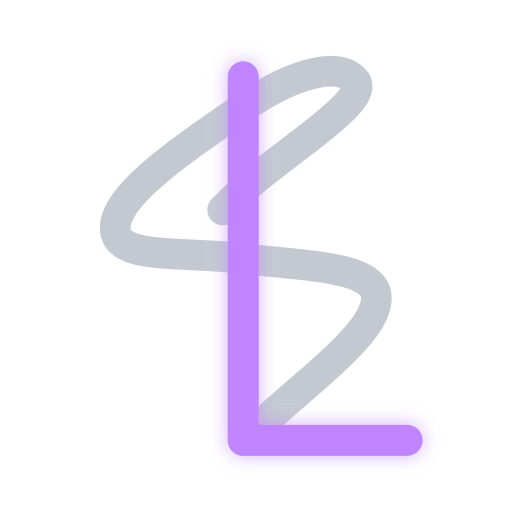
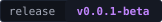
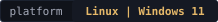
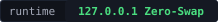
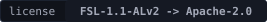
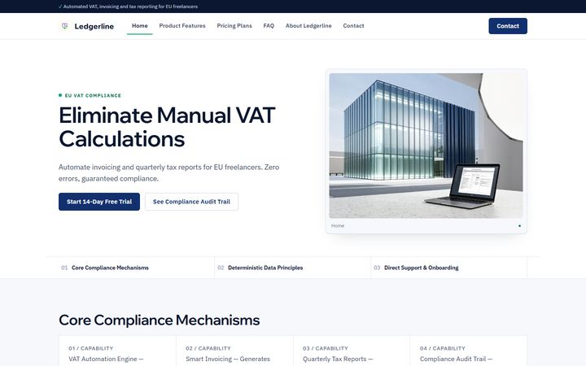
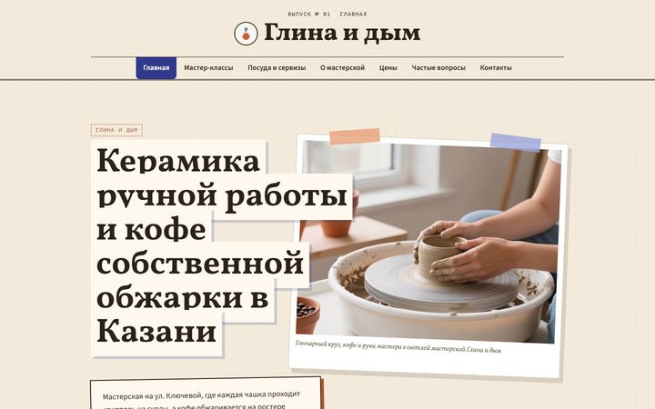
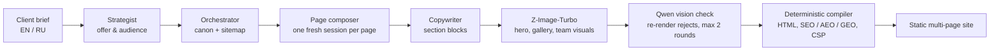

<p align="center">
  
</p>

<h1 align="center">SmartLLM Studio <code>v0.0.7-beta</code></h1>

<p align="center">
  <b>Build multi-page websites with a local AI — offline, free, on your own GPU.</b>
</p>

<p align="center">
  <b>English</b> | <a href="README.ru.md">Русский</a>
</p>

<p align="center">
  
  
  
  
</p>

---

## Live demos

Three real sites made end to end by SmartLLM Studio on one laptop GPU. Each was built from a short brief. The text, sitemap, layout and images all come from the local pipeline. Click a preview to open the live site.

<table>
  <tr>
    <td align="center" width="33%">
      <a href="https://vkvstudio.github.io/SmartLLM/ledgerline_en/"></a><br>
      <b><a href="https://vkvstudio.github.io/SmartLLM/ledgerline_en/">Ledgerline</a></b><br>
      <sub>Canon 17 · Fintech Institutional<br>English · 6 pages</sub>
    </td>
    <td align="center" width="33%">
      <a href="https://vkvstudio.github.io/SmartLLM/glina_i_dym_ru/"></a><br>
      <b><a href="https://vkvstudio.github.io/SmartLLM/glina_i_dym_ru/">Глина и дым</a></b><br>
      <sub>Canon 16 · Artisan Craft Zine<br>Russian · 7 pages</sub>
    </td>
    <td align="center" width="33%">
      <a href="https://vkvstudio.github.io/SmartLLM/northern_frame_enru/"></a><br>
      <b><a href="https://vkvstudio.github.io/SmartLLM/northern_frame_enru/">Northern Frame</a></b><br>
      <sub>Canon 13 · Cinematic Documentary<br>English + Russian · 5 pages</sub>
    </td>
  </tr>
</table>

<sub>These demos are beta output and are published as generated. The only exception is one Glina hero image, where an AI anatomy error (an extra hand) was retouched by hand. See <a href="#known-limitations">Known limitations</a>.</sub>

---

## Why SmartLLM

- **Private:** the brief, your copy and your images never leave your machine. Studio listens on `127.0.0.1` only.
- **Offline:** once the models are downloaded, no internet connection is needed. There are no cloud APIs and no API keys.
- **Free:** there are no subscriptions, no credits and no per-site fees. You pay only for your own electricity.
- **You own the output:** you get plain static HTML/CSS/JS and every image file, so there is no lock-in to a builder or a hosting service. See [`studio/OUTPUTS.md`](studio/OUTPUTS.md).
- **Your hardware:** it runs on one consumer NVIDIA GPU with 12 GB of VRAM.

---

## How it works

Studio runs an orchestrator that hands each job to a sub-agent in a **fresh session**. Each sub-agent gets only the system prompt and its own inputs, so no long chat history builds up. The steps run in sequence on one GPU, with only one model in VRAM at a time.



1. **Plan:** a strategist reads the brief. The orchestrator then picks one of 20 design canons and the sitemap, and a page composer lays out each page. Every plan is validated and re-requested with concrete errors if it fails.
2. **Write:** section copy is written in the site language (EN, RU or bilingual EN+RU).
3. **Draw:** Studio unloads `llama-server` and renders the visuals with `sd-cli` running Z-Image-Turbo.
4. **Check:** the Qwen vision projector checks each image against its brief (subject, style, anatomy). Rejected images are re-rendered, with at most 2 rounds.
5. **Compile:** a deterministic compiler writes HTML5, OKLCH design tokens, SHA-256 CSP, JSON-LD, `sitemap.xml`, `robots.txt` and `llms.txt`.

---

## Features

- **20 design canons:** Bento Grid, Swiss International, Editorial Magazine, Neo-Brutalism, Liquid Glass, Cinematic Documentary, Artisan Craft Zine, Fintech Institutional, Devtool Command UI and 11 more ([`kb/styles/canons_v2/`](studio/smartllm_studio/kb/styles/canons_v2/)). Canons 13, 16 and 17 have their own full layouts (header, hero, footer, CSS) as of 0.0.7. The other 17 share a common layout with canon tokens.
- **Multi-page sites:** the sitemap is decided per brief (for example index, services, pricing, portfolio, FAQ, about and contact), with shared navigation and per-page composition.
- **SEO / AEO / GEO:** canonical URLs, Open Graph, JSON-LD `@graph`, `sitemap.xml`, `robots.txt` and an `llms.txt` file for AI answer engines.
- **PageSpeed-minded output:** static files only, no framework runtime and a strict CSP without `unsafe-inline`.
- **EN / RU:** English, Russian, or a bilingual site with a language switch.
- **Two modes:** Automatic Mode (brief → site) or the 5-step Constructor.
- **Publish anywhere:** set the site domain (`seo.base_url`) in the project and the compiler writes the correct canonical and sitemap URLs.

<p align="center">
  
  <br><sub>SmartLLM Studio at <code>127.0.0.1:8090</code>: constructor and Automatic Mode, canon picker, live preview at 1440 / 834 / 390 and GPU/RAM telemetry.</sub>
</p>

### Measured on the three demos

These figures come from Lighthouse 13 on the live demo pages, run locally in Chrome:

| Category | Mobile | Desktop |
|---|---|---|
| Performance | 72–76 | 92–100 |
| Accessibility | 96 | 96 |
| Best Practices | 100 | 100 |
| SEO | 100 | 100 |

Mobile performance is limited by full-size PNG images; WebP and `srcset` are on the roadmap.

---

## Quick start

### Requirements

| | Minimum (tested) |
|---|---|
| GPU | NVIDIA with **12 GB VRAM** (tested on an RTX 4080 Laptop GPU), recent driver |
| RAM | **32 GB** |
| Disk | about **85 GB** after install, plus extra space while downloading. The installer computes the exact peak from the release sizes and aborts before downloading if space is short. |
| OS | Linux (glibc ≥ 2.35) or Windows 11 |
| Python | 3.11+ (`python3-venv` on Linux) |

### Option A: One-folder bundle (models + engines + Studio)

[`setup_bundle.py`](scripts/release/setup_bundle.py) uses only the Python standard library, resumes interrupted downloads and verifies SHA-256. It downloads the 55 GiB GGUF model (30 parts, reassembled) with the vision projector, Z-Image-Turbo, portable CUDA engine binaries and Studio into one `SmartLLM` folder:

**Linux**
```bash
curl -LO https://github.com/VKVstudio/SmartLLM/releases/download/v0.0.4-beta/setup_bundle.py
python3 setup_bundle.py --cleanup-parts
SmartLLM/studio/bin/smartllm-studio
```

**Windows 11 (PowerShell)**
```powershell
curl.exe -LO https://github.com/VKVstudio/SmartLLM/releases/download/v0.0.4-beta/setup_bundle.py
python setup_bundle.py --cleanup-parts
SmartLLM\studio\smartllm-studio.bat
```

Then open **http://127.0.0.1:8090**.

> The bundle currently ships the **v0.0.4-beta** Studio archive. To get the 0.0.7 pipeline (canon layouts, vision check, multi-page planner), also run Studio from source (Option B) and point **Settings** at the bundle's `models/` and `bin/`.

### Option B: Studio from source

**Linux**
```bash
git clone https://github.com/VKVstudio/SmartLLM.git
cd SmartLLM/studio
./install.sh
./bin/smartllm-studio
```

**Windows 11 (PowerShell)**
```powershell
git clone https://github.com/VKVstudio/SmartLLM.git
cd SmartLLM\studio
powershell -ExecutionPolicy Bypass -File .\install.ps1
.\smartllm-studio.bat
```

In **Settings**, set the paths to:
- `SmartLLM-v2-K320-V1.gguf` (55 GiB) and `mmproj-Qwen3.8-Flash-Next-BF16.gguf` (866 MB). They are in [release v0.0.1-beta](https://github.com/VKVstudio/SmartLLM/releases/tag/v0.0.1-beta) as split parts. Join them with [`reassemble_model.py`](scripts/release/reassemble_model.py), [`.sh`](scripts/release/reassemble_model.sh) or [`.ps1`](scripts/release/reassemble_model.ps1).
- `llama-server` and `sd-cli`, plus the Z-Image-Turbo weights (`z_image_turbo_bf16`, `qwen_3_4b`, `ae`). They are in [release v0.0.3-beta](https://github.com/VKVstudio/SmartLLM/releases/tag/v0.0.3-beta).

> **Offline npm cache:** `vendor/npm_offline/` (about 500 MB) is **not** in the git repo. It is only needed for fully offline TypeScript/Lighthouse checks and is distributed as a separate offline download.

### Example briefs

Ready-to-paste prompts are in [`studio/examples/`](studio/examples/). Architecture notes are in [`docs/ARCHITECTURE.md`](docs/ARCHITECTURE.md), and the CLI combine is described in [`docs/OFFLINE_COMBINE_QUICKSTART.md`](docs/OFFLINE_COMBINE_QUICKSTART.md).

---

## Hardware

| Machine | VRAM | RAM | LLM decode | Status |
|---|---|---|---|---|
| RTX 4080 Laptop GPU | 12 GB | 32 GiB | about 20 tok/s | Used to build all three demos |

Only one model is in VRAM at a time: Studio stops `llama-server` before starting `sd-cli`, and the reverse. Other GPUs have not been measured yet. Reports are welcome.

---

## FAQ

**Does it need the internet?**
Only to download the models once. Generation runs fully on `127.0.0.1`.

**Can I use the generated sites commercially?**
Yes. You own what you generate. See [`studio/OUTPUTS.md`](studio/OUTPUTS.md).

**How long does a site take?**
It depends on the number of pages and images. A 5–7 page site with images takes tens of minutes on the tested laptop, not seconds.

**Can I host the result anywhere?**
Yes. The output is a folder of static files. The demos above are served straight from GitHub Pages.

**AMD / Apple Silicon?**
Not supported yet. The engines are CUDA builds.

<a id="known-limitations"></a>
**Known limitations**
- The vision check can miss anatomy errors (extra hands or fingers). Review the people in images before you publish.
- Images are PNG only, so mobile Lighthouse performance is in the 70s.
- Bilingual sites use one URL with a JS language switch, with no separate `/ru/` pages and no `hreflang` yet.
- The site domain is set in the project file (`seo.base_url`) and is not in the UI yet.

---

## Roadmap

- Dedicated layouts for the other 17 canons
- WebP/AVIF output with responsive `srcset`
- A more reliable anatomy check in the vision stage
- Separate `/ru/` pages with `hreflang` for bilingual sites
- A domain / base URL field in the Studio UI
- An updated one-folder bundle that ships Studio 0.0.7

---

## License

- **Repository scripts (pruning, calibration, evaluation):** [Apache-2.0](LICENSE)
- **SmartLLM Studio (`studio/`):** [FSL-1.1-ALv2](studio/LICENSE.md), which becomes Apache-2.0 after 2 years. See also [`TRADEMARKS.md`](studio/TRADEMARKS.md), [`OUTPUTS.md`](studio/OUTPUTS.md) and [`THIRD_PARTY_NOTICES.md`](studio/THIRD_PARTY_NOTICES.md).
- **SmartLLM v2 GGUF weights:** `qwen-community-1.0`, distributed separately in Releases.
- **Z-Image-Turbo, Qwen3-4B text encoder and AE VAE:** Apache-2.0
- **Engine binaries (`llama-server`, `sd-cli`):** MIT forks of `llama.cpp` / `stable-diffusion.cpp`

Questions or corrections: **hello@vkvstudio.com**

---

## Кратко по-русски

**SmartLLM Studio** собирает многостраничные сайты локальной нейросетью: офлайн, бесплатно, на вашей видеокарте (NVIDIA, 12 ГБ VRAM, 32 ГБ RAM). Работа идёт так: бриф → стратег → оркестратор (канон и карта сайта) → композиция каждой страницы → тексты → картинки Z-Image → проверка зрением Qwen → статический сайт с SEO/AEO/GEO. В Studio 20 дизайн-канонов, поддерживаются RU, EN и двуязычные сайты. Примеры выше — живые демо на GitHub Pages. Подробная документация на русском: [README.ru.md](README.ru.md).

---

<div align="center">
  <a href="https://github.com/VKVstudio/.github/blob/main/DONATE.md">
    
  </a>
  <br>
  <sub>If this project saved you time, consider supporting its development.</sub>
</div>
