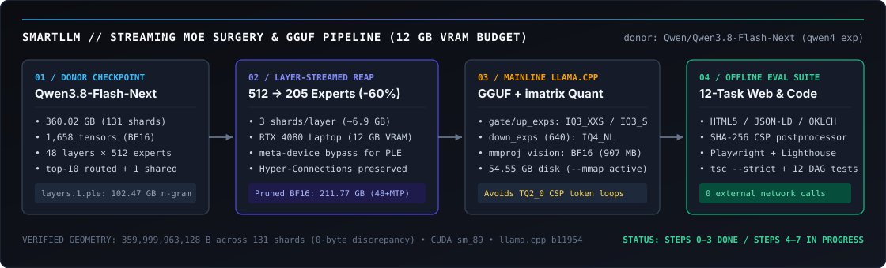
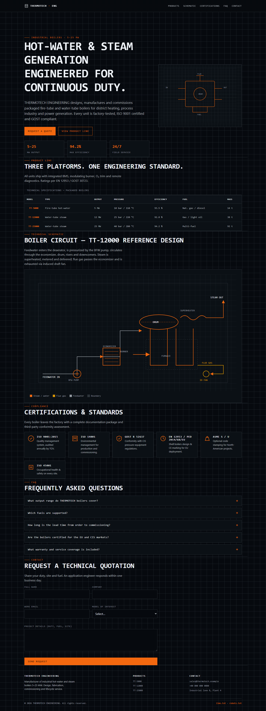
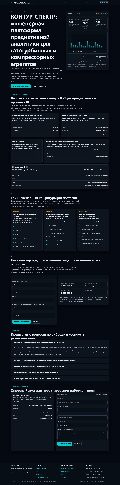
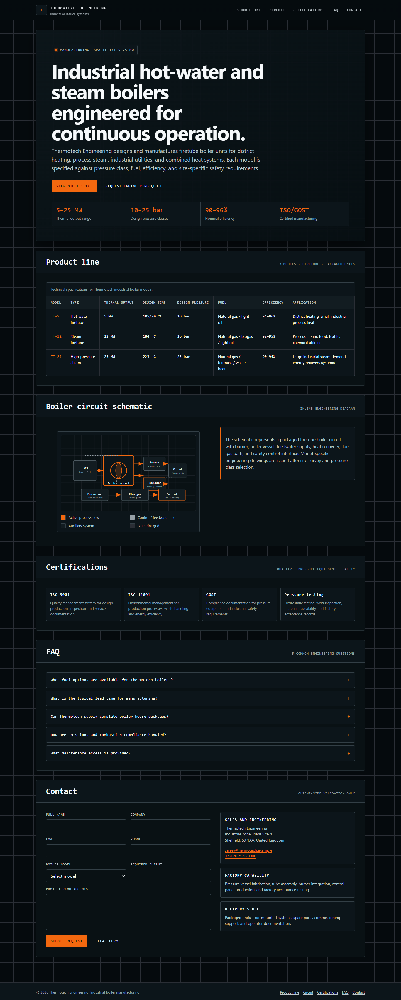
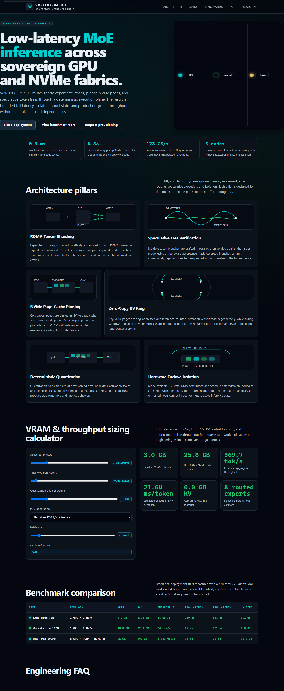

# SmartLLM

> **Status: Work in progress (active R&D).** Stages 0–3 (donor selection, byte-exact architecture verification across 131 shards, native Windows CUDA `sm_89` toolchain, and the 12-task offline evaluation harness with `Gyro-M` reference runs) are complete. Stages 4–7 (calibration dataset assembly, layer-streamed REAP `512 → 205` expert pruning, and `IQ3_XXS` / `IQ3_S` GGUF quantization) are actively in development.

Streaming REAP expert pruning (`512 → 205` experts per layer) and `llama.cpp` quantization of
`Qwen/Qwen3.8-Flash-Next` (`qwen4_exp`, 360 GB BF16) to fit a multimodal bilingual (EN/RU)
Design Engineer & Full-Stack Web model onto a single consumer laptop GPU (RTX 4080 Laptop,
12 GB VRAM, 32 GB RAM).

Not a wrapper around an API and not a toy notebook: the byte-level tensor verification, the
12-task headless browser and TypeScript evaluation harness (`eval/suite/`), and the baseline
runs across six model configurations below are finished and reproducible offline.

<p align="center">
  
</p>

---

## What is actually interesting here

**Streaming a 360 GB MoE through a 12 GB laptop GPU.**
`Qwen/Qwen3.8-Flash-Next` (`qwen4_exp`) spans 131 `.safetensors` shards (`359,999,963,128` bytes
across 1,658 tensors: 48 layers, 512 routed experts + 1 shared expert per layer, top-10 routing,
multi-stream Hyper-Connections, and a built-in MTP head). Loading it naively requires ~720 GB of
host RAM; even instantiating `layer_idx=1` on CPU triggers a 204.8 GB allocation inside
`Qwen4ExpTextNGramEmbedding.__init__` (`nn.Embedding(320001536, 160)` for the 102.47 GB static
n-gram PLE table). Our layer schedule ([`research/step5_6_layer_shard_schedule.json`](research/step5_6_layer_shard_schedule.json))
initializes the skeleton on `torch.device("meta")`, streams 3 lexicographically ordered shards
per layer (~6.91 GB of routed experts), runs the REAP saliency observer (`saliency = router_prob × ‖f_j(x)‖₂`)
entirely inside 12 GB VRAM, and evicts shards on exact `ref_count == 0` boundaries.

**Why 2-bit quantization breaks on security headers, proved empirically.**
Running `Gyro-M` (`TQ2_0`, 2.06 bpw ternary quantization of the unpruned 512-expert model)
through our 12-task benchmark exposed a concrete failure mode of extreme 2-bit quantization. On
tasks that do not stalls on security hashes, `Gyro-M` scores **7.95 / 10** (`t1–t3` mean **8.72 / 10**).
On 4 of the 12 tasks (`t5, t7, t8, t11`), the moment the 2-bit model attempts to emit a
high-entropy base64 `'sha256-...'` string inside `<meta http-equiv="Content-Security-Policy">`,
its token distribution collapses into an infinite repetition loop before `<body>` ever opens,
dragging the 12-task mean down to **5.40 / 10**. We address that from both sides: pruning expert
count (`512 → 205`, `-60%`) so surviving weights stay at 3-bit/4-bit (`IQ3_XXS` / `IQ3_S` with
mainline `llama.cpp`'s automatic `IQ4_NL` fallback on `ffn_down_exps` where `ne[0] = 640` is
indivisible by 256), and moving SHA-256 CSP digest calculation into a deterministic postprocessor
([`eval/suite/audit_suite.py`](eval/suite/audit_suite.py)).

**An offline benchmark that tests what ships, not multiple-choice trivia.**
[`eval/suite/`](eval/suite/) evaluates 12 bilingual (EN/RU) production tasks (`t1–t12`):
multimodal UI reconstruction from a reference PNG (`t2`), kinetic editorial grids, interactive
Canvas/SVG data visualizations, a broken-layout diagnostic audit (`t12`), and a strict
TypeScript concurrent DAG executor (`t4`) verified against 12 worker-isolated unit tests with
hard 3,000 ms timeouts ([`eval/suite/test_dag_runner.mjs`](eval/suite/test_dag_runner.mjs)).
Every HTML artifact is audited statically (HTML5 landmarks, JSON-LD, OKLCH palette, zero external
requests) and rendered in headless Playwright Chromium at `1440×900` and `375×812` with bundled
Lighthouse in port-free `file://` snapshot mode ([`eval/suite/browser_and_lh_suite.mjs`](eval/suite/browser_and_lh_suite.mjs)).

**Primary-source verification before touching weights.**
Early exploratory notes contained 14 plausible-sounding fabrications about tensor shapes, PLE
storage, and `llama.cpp` flags. Before writing a line of surgery code, every tensor shape, byte
offset, and quantizer constraint in [`docs/ARCHITECTURE.md`](docs/ARCHITECTURE.md) and
[`docs/DATA.md`](docs/DATA.md) was verified directly against the 131 shard headers,
`transformers` `modeling_qwen4_exp.py`, and mainline `llama.cpp` (`conversion/qwen4exp.py`,
`src/models/qwen4exp.cpp`, `src/llama-quant.cpp`), with zero bytes of discrepancy across
`359,999,963,128` bytes.

---

## Benchmark & visual outputs

### Baseline & reference scores (`eval/baseline/`, `eval/round2/`, `eval/suite/`)

| Configuration | Quantization / Mode | `t1` (Kinetic Landing) | `t2` (Multimodal PNG) | `t3` (RU Editorial) | `t1–t3` Mean | Full 12-Task Suite (`t1–t12`) |
| --- | --- | :---: | :---: | :---: | :---: | :---: |
| **`Qwen3.8-Flash-Next` (donor)** | BF16 (`think-8k`) | **9.65** | **9.10** | **9.60** | **9.45 / 10** | Reference ceiling |
| **`Gyro-M` (local 512-exp reference)** | `TQ2_0` (2.06 bpw, `think-4k`) | 8.70 | 8.65 | 8.80 | **8.72 / 10** | **7.95 / 10** (8 non-looping) · **5.40 / 10** (all 12)* |
| **`Qwen3.8-Flash-Next`** | BF16 (`no-think`) | 8.95 | 8.55 | 6.09 | **7.86 / 10** | — |
| **`Ling-3.0-Flash-VL`** | BF16 (baseline) | 8.65 | 8.10 | 8.15 | **8.30 / 10** | Rejected (weaker RU typography) |
| **`Gemma-4-31B-IT`** | BF16 (baseline) | 7.90 | 7.45 | 7.60 | **7.65 / 10** | Rejected (dense 31B, slow on 12 GB) |

*\*On `t5, t7, t8, t11`, 2-bit `TQ2_0` enters an infinite token repetition loop inside `<meta http-equiv="Content-Security-Policy">` before `<body>` opens ([`eval/suite/results/reference.md`](eval/suite/results/reference.md)).*

### Rendered outputs from the evaluation harness (`1440×900` Playwright captures)

<table>
  <tr>
    <td width="50%" valign="top">
      
      <p align="center"><sub><b>Donor ceiling (<code>qwen3.8-think-8k</code>, 9.65/10)</b> — <code>t1</code> dark brutalist architectural landing page, OKLCH palette, inline SVG geometry.</sub></p>
    </td>
    <td width="50%" valign="top">
      
      <p align="center"><sub><b>Local reference (<code>gyro-m-local</code>, 9.00/10)</b> — <code>t10</code> interactive WebAudio/Canvas brutalist synthesizer deck, 0 console errors.</sub></p>
    </td>
  </tr>
  <tr>
    <td width="50%" valign="top">
      
      <p align="center"><sub><b>Local reference (<code>gyro-m-local</code>, 8.70/10)</b> — <code>t1</code> editorial grid, Lighthouse Performance 1.00 / Accessibility 1.00 / SEO 1.00.</sub></p>
    </td>
    <td width="50%" valign="top">
      
      <p align="center"><sub><b>Local reference (<code>gyro-m-local</code>, 8.20/10)</b> — <code>t6</code> real-time Canvas telemetry &amp; node topology inspector, zero external assets.</sub></p>
    </td>
  </tr>
</table>

---

## Running it

The evaluation suite runs completely offline (zero GPU required for auditing, zero network calls,
zero open TCP ports — Lighthouse runs in `file://` snapshot mode).

```powershell
# 1. Static HTML5 / SEO / JSON-LD / OKLCH audit + deterministic SHA-256 CSP postprocessor + tsc/DAG tests:
.venv\Scripts\python.exe eval\suite\audit_suite.py

# 2. Headless Playwright Chromium (1440x900 & 375x812) + bundled Lighthouse snapshot audit:
node eval\suite\browser_and_lh_suite.mjs

# 3. Standalone TypeScript strict check + 12 worker-isolated DAG unit tests (3000 ms timeout/test):
node eval\suite\test_dag_runner.mjs eval\suite\ref\dag_reference.ts

# 4. Aggregate blind judge JSON scores and flag >2.0-point discrepancies:
.venv\Scripts\python.exe eval\suite\aggregate_judges.py

# 5. Native Windows 11 CUDA sm_89 + qwen4_exp 4-layer forward smoke test (meta-device PLE bypass):
.venv\Scripts\python.exe scripts\step2_smoke_test.py
```

---

## Honest state

- **No pruned GGUF checkpoint is published yet.** Steps 0–3 (donor selection, byte-level
  architecture verification across 131 shards, native Windows CUDA `sm_89` + `llama.cpp` `b11954`
  environment, and the 12-task `eval/suite/` benchmark with `Gyro-M` reference runs) are **DONE**.
  The full 360.02 GB `Qwen/Qwen3.8-Flash-Next` donor checkpoint is downloaded and verified locally;
  Steps 4–7 (calibration dataset assembly, 3-layer REAP pilot, full 48-layer `512 → 205` pruning,
  and `IQ3_XXS` / `IQ3_S` GGUF quantization) are next in the pipeline.
- **54.55 GB GGUF still streams experts from NVMe.** Pruning `512 → 205` experts per layer and
  quantizing to `IQ3_XXS` / `IQ3_S` brings the checkpoint from 360.00 GB down to **54.55–56.08 GB**
  on disk (including the 15.69 GB static PLE table and `IQ4_NL` `ffn_down_exps` fallback). On a
  12 GB VRAM / 32 GB RAM machine, `llama.cpp` must run with `--mmap` enabled; `--no-mmap` will
  immediately OOM host RAM.
- **Built-in MTP shares `hparams.n_expert`.** Mainline `llama.cpp` (`src/models/qwen4exp.cpp`)
  uses a single `n_expert` hyperparameter for all 48 decoder layers and the built-in Multi-Token
  Prediction head (`mtp.layers.0.mlp.experts.*`). Either MTP is pruned to the same 205 experts or
  its `mtp.*` tensors are stripped at GGUF conversion time.

| Stage | Milestone | Status | Artifact |
| :---: | --- | :---: | --- |
| **0** | Donor selection (`Qwen3.8-Flash-Next` vs `Ling-3.0` vs `Gemma-4-31B`) | **DONE** | [`eval/baseline/REPORT.md`](eval/baseline/REPORT.md), [`eval/round2/REPORT.md`](eval/round2/REPORT.md) |
| **1** | Byte-exact verification of 1,658 tensors across 131 shards (`360.00 GB`) | **DONE** | [`docs/DATA.md`](docs/DATA.md), [`research/step5_6_layer_shard_schedule.json`](research/step5_6_layer_shard_schedule.json) |
| **2** | Native Windows 11 CUDA `sm_89` toolchain, patched `transformers`, `llama.cpp` `b11954` | **DONE** | [`scripts/step2_smoke_test.py`](scripts/step2_smoke_test.py), [`docs/ARCHITECTURE.md`](docs/ARCHITECTURE.md) |
| **3** | 12-task offline benchmark (`eval/suite/`) + local `Gyro-M` (`TQ2_0`) evaluation | **DONE** | [`eval/suite/results/reference.md`](eval/suite/results/reference.md), [`eval/suite/results/judges_aggregated.json`](eval/suite/results/judges_aggregated.json) |
| **4** | Stratified multimodal calibration dataset (`PremiumWebStudio-Calib.jsonl`, 320 prompts) | **NEXT** | [`docs/DATA.md`](docs/DATA.md) |
| **5–6** | Layer-streamed REAP observer pilot (3 layers) & full 48-layer pruning (`512 → 205`) | **TODO** | [`research/step5_6_layer_shard_schedule.json`](research/step5_6_layer_shard_schedule.json) |
| **7–8** | Mainline `llama.cpp` `imatrix` + `IQ3_XXS` / `IQ3_S` GGUF + `mmproj` & post-surgery eval | **TODO** | [`docs/ARCHITECTURE.md`](docs/ARCHITECTURE.md), [`docs/DATA.md`](docs/DATA.md) |
| **9–10** | Standalone launcher, MCP bridge (`llama-server --mmap` + CSP hook + Playwright loop) & release | **TODO** | [`docs/ARCHITECTURE.md`](docs/ARCHITECTURE.md) |

---

## Layout

| Path | What is in it |
| --- | --- |
| [`docs/ARCHITECTURE.md`](docs/ARCHITECTURE.md) | Verified `qwen4_exp` architecture, memory hierarchy, REAP math, and `llama.cpp` constraints |
| [`docs/DATA.md`](docs/DATA.md) | Exact byte geometry of the 1,658 tensors (131 shards) and evaluation JSON schemas |
| [`eval/suite/`](eval/suite/) | 12-task benchmark: `tasks.json`, `audit_suite.py`, `browser_and_lh_suite.mjs`, `test_dag_runner.mjs`, `aggregate_judges.py` |
| [`eval/suite/runs/gyro-m-local/`](eval/suite/runs/gyro-m-local/) | Raw and CSP-postprocessed HTML/TS outputs, `1440×900` / `375×812` captures, and audit logs for `Gyro-M` |
| [`eval/baseline/`](eval/baseline/), [`eval/round2/`](eval/round2/) | Donor comparison runs and reasoning-budget ablations |
| [`research/step5_6_layer_shard_schedule.json`](research/step5_6_layer_shard_schedule.json) | Machine-readable 48-layer shard streaming and `ref_count == 0` eviction schedule |
| [`scripts/`](scripts/) | Smoke-test, shard-schedule builder, local evaluation runner, and official HF checkpoint downloader |

---

## License

Open-source under the **[Apache License 2.0](LICENSE)** (matching upstream `Qwen/Qwen3.8-Flash-Next`
and `CerebrasResearch/reap`).

Questions, or something here that looks wrong: **hello@vkvstudio.com**.
