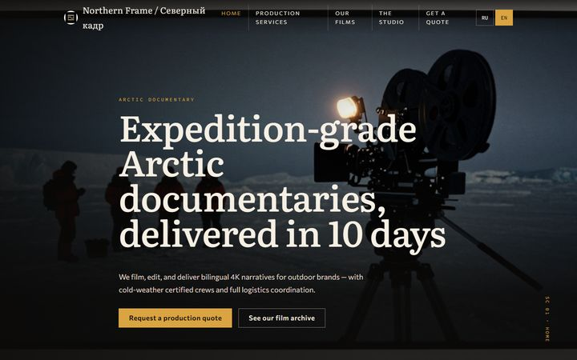
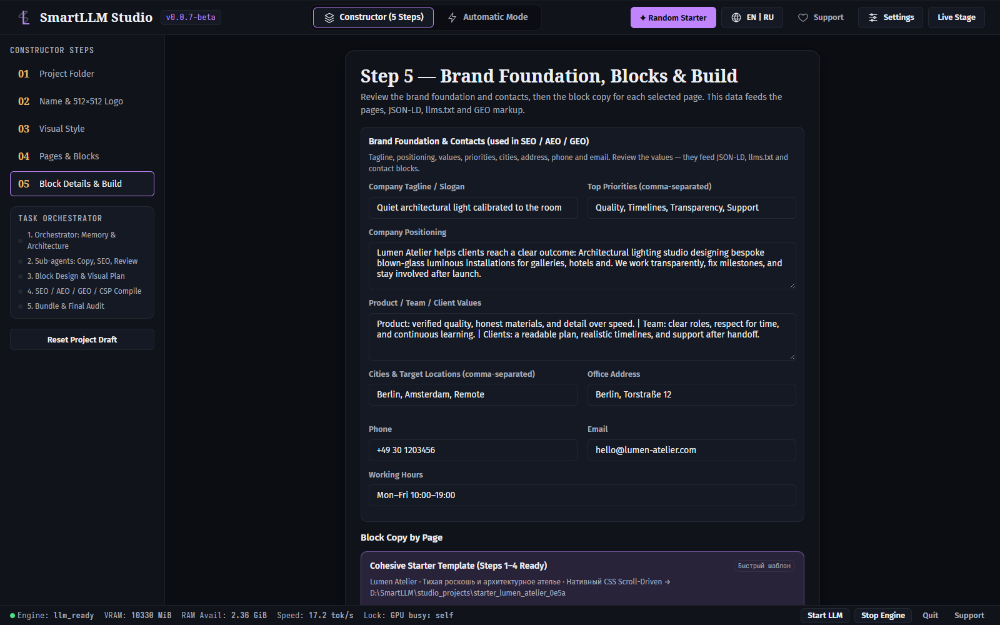
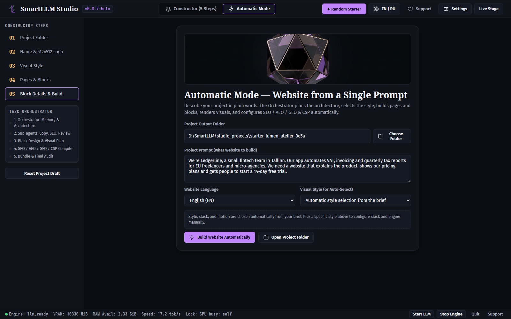
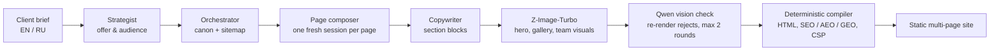

<p align="center">
  
</p>

<h1 align="center">SmartLLM Studio <code>v0.0.7-beta</code></h1>

<p align="center">
  <b>Build multi-page websites with a local AI — offline, free, on your own GPU.</b>
</p>

<p align="center">
  <b>English</b> | <a href="README.ru.md">Русский</a>
</p>

<p align="center">
  
  
  
  
</p>

> [!IMPORTANT]
> **This is a public beta for testing.** The full pipeline works, but expect rough edges. AI-generated images in particular are sometimes flawed (see [Known limitations](#known-limitations)). Please report bugs and send feedback through **[GitHub Issues](https://github.com/VKVstudio/SmartLLM/issues)**.

---

## Live demos

Three real sites built end to end by SmartLLM Studio on one laptop GPU, each from a short brief. The local pipeline produced the text, sitemap, layout and images. Click a preview to open the live site.

<table>
  <tr>
    <td align="center" width="33%">
      <a href="https://vkvstudio.github.io/SmartLLM/ledgerline_en/"></a><br>
      <b><a href="https://vkvstudio.github.io/SmartLLM/ledgerline_en/">Ledgerline</a></b><br>
      <sub>Canon 17 · Fintech Institutional<br>English · 6 pages</sub>
    </td>
    <td align="center" width="33%">
      <a href="https://vkvstudio.github.io/SmartLLM/glina_i_dym_ru/"></a><br>
      <b><a href="https://vkvstudio.github.io/SmartLLM/glina_i_dym_ru/">Глина и дым</a></b><br>
      <sub>Canon 16 · Artisan Craft Zine<br>Russian · 7 pages</sub>
    </td>
    <td align="center" width="33%">
      <a href="https://vkvstudio.github.io/SmartLLM/northern_frame_enru/"></a><br>
      <b><a href="https://vkvstudio.github.io/SmartLLM/northern_frame_enru/">Northern Frame</a></b><br>
      <sub>Canon 13 · Cinematic Documentary<br>English + Russian · 5 pages</sub>
    </td>
  </tr>
</table>

<sub>The demos are published as generated, with one exception: a Glina hero image had an AI anatomy error (an extra hand) that was retouched by hand. Some of the other demo images still miss their brief. That is the current state of the beta, not a curated best case.</sub>

---

## SmartLLM Studio 0.0.7-beta

<table>
  <tr>
    <td width="50%"></td>
    <td width="50%"></td>
  </tr>
  <tr>
    <td align="center"><sub><b>Constructor (5 steps):</b> project folder, logo, visual style, pages & blocks, block details & build. The live GPU/RAM status bar sits at the bottom.</sub></td>
    <td align="center"><sub><b>Automatic Mode:</b> one prompt plus language and style (or auto-select). The orchestrator does the rest.</sub></td>
  </tr>
</table>

<sub>Real screenshots of the 0.0.7-beta app, freshly installed with <code>setup_bundle.py</code>, with the model paths set in Settings. The company data shown comes from the built-in random starter template, not a real client.</sub>

---

## Why SmartLLM

- **Private:** your brief, copy and images stay on your machine. Studio listens on `127.0.0.1` only.
- **Offline:** once the models are downloaded, no internet connection is needed. There are no cloud APIs and no API keys.
- **Free:** no subscriptions, credits or per-site fees.
- **You own the output:** plain static HTML/CSS/JS plus every image file. There is no builder lock-in and no forced hosting. See [`studio/OUTPUTS.md`](studio/OUTPUTS.md).
- **Your hardware:** runs on one consumer NVIDIA GPU with 12 GB of VRAM.

---

## How it works

Studio runs an orchestrator that hands each job to a sub-agent in a **fresh session**. Each session gets only the system prompt and its own inputs, so no long chat history builds up. The steps run one after another on a single GPU, with only one model in VRAM at a time.



1. **Plan:** a strategist reads the brief. The orchestrator then picks one of 20 design canons and the sitemap, and a page composer lays out each page. Every plan is validated; if it fails, it is requested again with the concrete errors.
2. **Write:** section copy is written in the site language (EN, RU or bilingual EN+RU).
3. **Draw:** Studio unloads `llama-server` and renders the visuals with `sd-cli` (Z-Image-Turbo).
4. **Check:** the Qwen vision projector checks each image against its brief (subject, style, anatomy) and re-renders rejects, for at most 2 rounds.
5. **Compile:** a deterministic compiler writes HTML5, OKLCH design tokens, a SHA-256 CSP, JSON-LD, `sitemap.xml`, `robots.txt` and `llms.txt`.

---

## Features

- **20 design canons:** Bento Grid, Swiss International, Editorial Magazine, Neo-Brutalism, Liquid Glass, Cinematic Documentary, Artisan Craft Zine, Fintech Institutional, Devtool Command UI and 11 more ([`canons_v2/`](studio/smartllm_studio/kb/styles/canons_v2/)). Canons 13, 16 and 17 have their own full layouts (header, hero, footer and CSS). The other 17 share a common layout styled with each canon's tokens.
- **Multi-page sites:** the sitemap is decided per brief (for example index, services, pricing, portfolio, FAQ, about and contact), with shared navigation and per-page composition.
- **SEO / AEO / GEO:** canonical URLs, Open Graph, JSON-LD `@graph`, `sitemap.xml`, `robots.txt`, and `llms.txt` for AI answer engines.
- **PageSpeed-minded output:** static files only, no framework runtime, and a strict CSP without `unsafe-inline`.
- **EN / RU:** English, Russian, or a bilingual site with a language switch. The Studio UI itself is EN/RU too.
- **Two modes:** Automatic Mode (brief → site) or the 5-step Constructor.
- **Publish anywhere:** set the site domain (`seo.base_url`) in the project, and the compiler writes the correct canonical and sitemap URLs.

### Measured on the three demos

Lighthouse 13 (Chrome, default throttling) on the live GitHub Pages home page of each demo, measured on 24 Nov 2026:

| Demo | Performance (mobile) | Performance (desktop) | Accessibility | Best Practices | SEO |
|---|---|---|---|---|---|
| Ledgerline | 76 | 97 | 96 | 100 | 100 |
| Глина и дым | 76 | 100 | 96 | 100 | 100 |
| Northern Frame | 99 | 100 | 96 | 100 | 100 |

On image-heavy pages, mobile performance is held back by full-size PNG images (mobile LCP of about 7 s on Ledgerline and Glina). WebP and `srcset` are on the roadmap.

---

## Quick start

### Requirements

| | Minimum (tested) |
|---|---|
| GPU | NVIDIA with **12 GB VRAM** (tested: RTX 4080 Laptop GPU), recent driver |
| RAM | **32 GB** |
| Disk | about **85 GB** after install. Downloading needs more; the installer computes the peak from the real release sizes and stops before downloading if there is not enough space. |
| OS | Windows 11 or Linux (glibc ≥ 2.35) |
| Python | 3.11+ (`python3-venv` on Linux) |

### Option A: One-folder bundle (recommended)

[`setup_bundle.py`](scripts/release/setup_bundle.py) is pure Python stdlib, resumable and SHA-256 verified. It creates one `SmartLLM` folder containing:
- **Studio 0.0.7-beta.** It uses the v0.0.7-beta Release package if one is published, otherwise the source archive of the `v0.0.7-beta` tag. The contents are the same either way.
- **The 55 GiB GGUF model** (30 parts, reassembled and verified) and the vision projector, from [release v0.0.1-beta](https://github.com/VKVstudio/SmartLLM/releases/tag/v0.0.1-beta).
- **Z-Image-Turbo weights and the portable CUDA engines** (`llama-server`, `sd-cli`), from [release v0.0.3-beta](https://github.com/VKVstudio/SmartLLM/releases/tag/v0.0.3-beta).
- A local Python venv with Pillow.

**Windows 11 (PowerShell)**
```powershell
curl.exe -LO https://raw.githubusercontent.com/VKVstudio/SmartLLM/v0.0.7-beta/scripts/release/setup_bundle.py
python setup_bundle.py --cleanup-parts
SmartLLM\studio\smartllm-studio.bat
```

**Linux**
```bash
curl -LO https://raw.githubusercontent.com/VKVstudio/SmartLLM/v0.0.7-beta/scripts/release/setup_bundle.py
python3 setup_bundle.py --cleanup-parts
SmartLLM/studio/bin/smartllm-studio
```

Then open **http://127.0.0.1:8090**. Useful flags: `--dest D:\SmartLLM` picks another folder; `--skip-model --skip-zimage --skip-binaries` installs Studio only; `--studio-ref main` installs the latest `main` instead of the release tag.

### Option B: From source (git clone or "Download ZIP")

**Windows 11 (PowerShell)**
```powershell
git clone https://github.com/VKVstudio/SmartLLM.git
cd SmartLLM\studio
powershell -ExecutionPolicy Bypass -File .\install.ps1
.\smartllm-studio.bat
```

**Linux**
```bash
git clone https://github.com/VKVstudio/SmartLLM.git
cd SmartLLM/studio
./install.sh
./bin/smartllm-studio
```

The installer creates a venv with Pillow and a shortcut. No model weights are downloaded. Studio opens on **http://127.0.0.1:8090**. If models or engines are missing, Studio shows a banner with a one-click **download everything** button, which runs `setup_bundle.py` for you. You can also enter the paths yourself under **Settings**:
- `SmartLLM-v2-K320-V1.gguf` (55 GiB) and `mmproj-Qwen3.8-Flash-Next-BF16.gguf` (866 MB). Both are in [release v0.0.1-beta](https://github.com/VKVstudio/SmartLLM/releases/tag/v0.0.1-beta) as split parts; join them with [`reassemble_model.py`](scripts/release/reassemble_model.py) (or [`.sh`](scripts/release/reassemble_model.sh) / [`.ps1`](scripts/release/reassemble_model.ps1)).
- `llama-server`, `sd-cli` and the Z-Image-Turbo weights (`z_image_turbo_bf16`, `qwen_3_4b`, `ae`), all from [release v0.0.3-beta](https://github.com/VKVstudio/SmartLLM/releases/tag/v0.0.3-beta).

> **Offline npm cache:** `vendor/npm_offline/` (about 500 MB) is **not** in the git repo. Studio does not need it. It is only used for fully offline TypeScript/Lighthouse checks and is distributed as a separate offline download.

### Example briefs

Ready-to-paste prompts are in [`studio/examples/`](studio/examples/). Architecture notes: [`docs/ARCHITECTURE.md`](docs/ARCHITECTURE.md). The CLI combine is described in [`docs/OFFLINE_COMBINE_QUICKSTART.md`](docs/OFFLINE_COMBINE_QUICKSTART.md).

---

## Hardware

| Machine | VRAM | RAM | LLM decode | Status |
|---|---|---|---|---|
| RTX 4080 Laptop GPU | 12 GB | 32 GiB | about 18–20 tok/s | Built all three demos |

Only one model is in VRAM at a time: Studio stops `llama-server` before starting `sd-cli`, and the other way round. Other GPUs have not been measured yet. Reports are welcome in [Issues](https://github.com/VKVstudio/SmartLLM/issues).

---

## FAQ

**Does it need the internet?**
Only once, to download the models. Generation runs fully on `127.0.0.1`.

**Can I use the generated sites commercially?**
Yes. You own what you generate; see [`studio/OUTPUTS.md`](studio/OUTPUTS.md).

**How long does a site take?**
It depends on the number of pages and images. A 5–7 page site with images takes tens of minutes on the tested laptop, not seconds.

**Will every image be good?**
No. See [Known limitations](#known-limitations). Plan to review the images and re-render or replace the weak ones.

**Can I host the result anywhere?**
Yes. The output is a folder of static files; the demos above are served directly from GitHub Pages.

**AMD / Apple Silicon?**
Not supported yet. The engines are CUDA builds.

<a id="known-limitations"></a>
### Known limitations

- **Generated images are sometimes flawed.** Z-Image can produce anatomy errors (extra hands or fingers, odd poses), and some images do not match their brief: the wrong subject, or a generic stock-like scene. The Qwen vision check catches part of this and re-renders, but it misses some errors (it passed the extra hand in the Glina demo). Review every image with people before you publish.
- Images are PNG only, so mobile Lighthouse performance drops to the mid-70s on image-heavy pages.
- Bilingual sites use one URL with a JS language switch. There are no separate `/ru/` pages and no `hreflang` yet.
- The site domain is set in the project file (`seo.base_url`); there is no field for it in the UI yet.
- Only canons 13, 16 and 17 have dedicated layouts. Sites in the other 17 canons look more alike.

---

## Roadmap

Everything below is **planned and not implemented yet**:

- **Expert mode (extended constructor):** choose the style of each block, edit image prompts before rendering, fine-tune SEO / GEO / AEO settings per page, and more
- Dedicated layouts for the remaining 17 canons
- WebP/AVIF output with responsive `srcset`
- A more reliable anatomy and subject check in the vision stage
- Separate `/ru/` pages with `hreflang` for bilingual sites
- A domain / base URL field in the Studio UI

---

## License

- **Repository scripts (pruning, calibration, evaluation):** [Apache-2.0](LICENSE)
- **SmartLLM Studio (`studio/`):** [FSL-1.1-ALv2](studio/LICENSE.md), which becomes Apache-2.0 after 2 years. See also [`TRADEMARKS.md`](studio/TRADEMARKS.md), [`OUTPUTS.md`](studio/OUTPUTS.md) and [`THIRD_PARTY_NOTICES.md`](studio/THIRD_PARTY_NOTICES.md).
- **SmartLLM v2 GGUF weights:** `qwen-community-1.0`, distributed separately in Releases.
- **Z-Image-Turbo, Qwen3-4B text encoder, AE VAE:** Apache-2.0
- **Engine binaries (`llama-server`, `sd-cli`):** MIT forks of `llama.cpp` / `stable-diffusion.cpp`

Questions or corrections: **hello@vkvstudio.com** · Bugs and feedback: [GitHub Issues](https://github.com/VKVstudio/SmartLLM/issues)

---

<div align="center">
  <a href="https://github.com/VKVstudio/.github/blob/main/DONATE.md">
    
  </a>
  <br>
  <sub>If this project saved you time, consider supporting its development.</sub>
</div>
