<p align="center">
  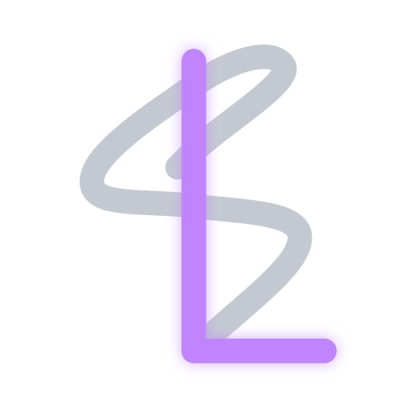
</p>

<h1 align="center">SmartLLM Studio <code>v0.0.7-beta</code></h1>

<p align="center">
  <b>Многостраничные сайты с локальной нейросетью — офлайн, бесплатно, на вашей видеокарте.</b>
</p>

<p align="center">
  <a href="README.md">English</a> | <b>Русский</b>
</p>

<p align="center">
  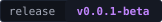
  
  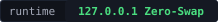
  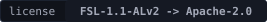
</p>

> [!IMPORTANT]
> **Это публичная бета-версия для тестирования.** Весь конвейер работает, но шероховатости будут. Особенно это касается картинок: нейросеть иногда рисует их с ошибками (см. [Известные ограничения](#known-limitations)). Об ошибках и с отзывами пишите в **[GitHub Issues](https://github.com/VKVstudio/SmartLLM/issues)**.

---

## Живые демо

Три настоящих сайта, которые SmartLLM Studio собрала целиком на одной ноутбучной видеокарте, каждый по короткому брифу. Тексты, карту сайта, вёрстку и картинки сделал локальный конвейер. Нажмите на превью, чтобы открыть сайт.

<table>
  <tr>
    <td align="center" width="33%">
      <a href="https://vkvstudio.github.io/SmartLLM/ledgerline_en/">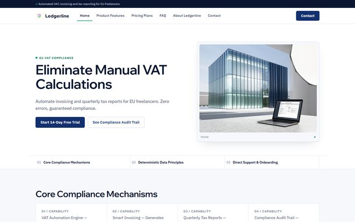</a><br>
      <b><a href="https://vkvstudio.github.io/SmartLLM/ledgerline_en/">Ledgerline</a></b><br>
      <sub>Канон 17 · Fintech Institutional<br>Английский · 6 страниц</sub>
    </td>
    <td align="center" width="33%">
      <a href="https://vkvstudio.github.io/SmartLLM/glina_i_dym_ru/">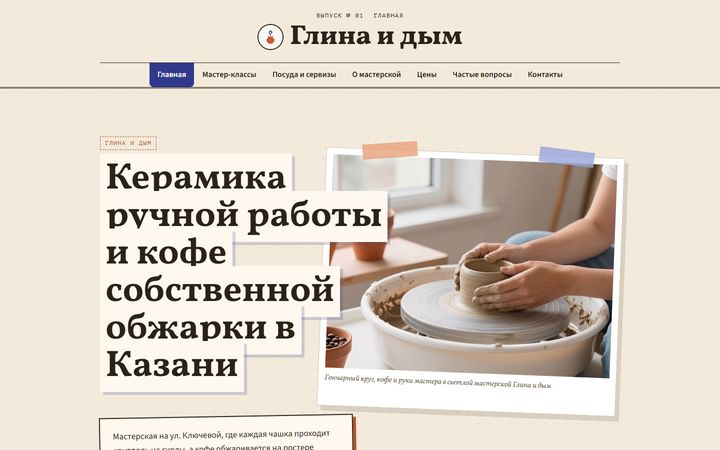</a><br>
      <b><a href="https://vkvstudio.github.io/SmartLLM/glina_i_dym_ru/">Глина и дым</a></b><br>
      <sub>Канон 16 · Artisan Craft Zine<br>Русский · 7 страниц</sub>
    </td>
    <td align="center" width="33%">
      <a href="https://vkvstudio.github.io/SmartLLM/northern_frame_enru/">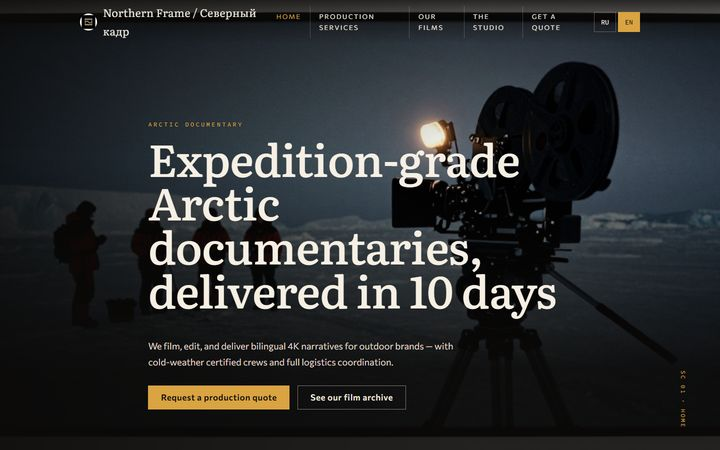</a><br>
      <b><a href="https://vkvstudio.github.io/SmartLLM/northern_frame_enru/">Northern Frame</a></b><br>
      <sub>Канон 13 · Cinematic Documentary<br>Английский + русский · 5 страниц</sub>
    </td>
  </tr>
</table>

<sub>Демо опубликованы в том виде, в каком их собрал конвейер, с одним исключением: в главной картинке «Глины и дыма» нейросеть нарисовала лишнюю руку, и её убрали вручную. Часть остальных картинок в демо по-прежнему не совпадает с брифом. Это реальное состояние беты, а не отобранные лучшие примеры.</sub>

---

## SmartLLM Studio 0.0.7-beta

<table>
  <tr>
    <td width="50%">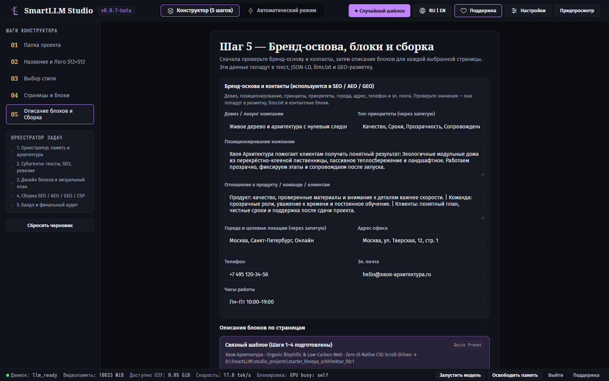</td>
    <td width="50%">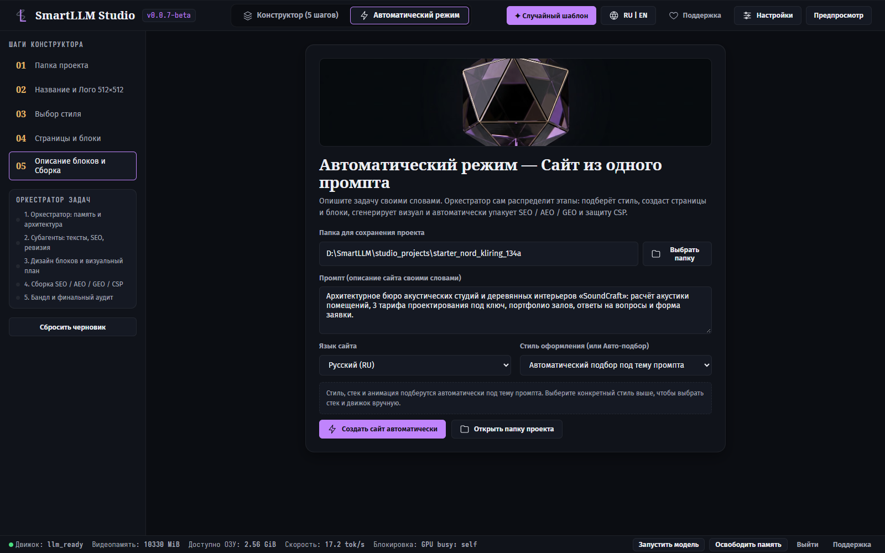</td>
  </tr>
  <tr>
    <td align="center"><sub><b>Конструктор (5 шагов):</b> папка проекта, логотип, стиль, страницы и блоки, детали блоков и сборка. Внизу — живая строка состояния GPU/ОЗУ.</sub></td>
    <td align="center"><sub><b>Автоматический режим:</b> один запрос плюс язык и стиль (или автовыбор). Остальное делает оркестратор.</sub></td>
  </tr>
</table>

<sub>Настоящие скриншоты приложения 0.0.7-beta сразу после установки через <code>setup_bundle.py</code>; пути к моделям заданы в настройках. Данные компании на экране взяты из встроенного случайного стартового шаблона, это не реальный клиент.</sub>

---

## Почему SmartLLM

- **Приватно:** бриф, тексты и картинки не покидают ваш компьютер. Studio слушает только `127.0.0.1`.
- **Офлайн:** после загрузки моделей интернет не нужен. Нет облачных API и API-ключей.
- **Бесплатно:** без подписок, кредитов и платы за сайт.
- **Результат ваш:** обычные статические HTML/CSS/JS и все файлы картинок. Нет привязки к конструктору и навязанного хостинга. См. [`studio/OUTPUTS.md`](studio/OUTPUTS.md).
- **Ваше железо:** работает на одной потребительской видеокарте NVIDIA с 12 ГБ видеопамяти.

---

## Как это работает

Studio запускает оркестратор, который передаёт каждую задачу субагенту в **свежей сессии**. Каждая сессия получает только системный промпт и свои входные данные, поэтому длинная история переписки не накапливается. Шаги идут по очереди на одной видеокарте, и в видеопамяти всегда только одна модель.

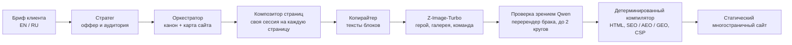

1. **План:** стратег разбирает бриф. Затем оркестратор выбирает один из 20 дизайн-канонов и карту сайта, а композитор раскладывает каждую страницу. Каждый план проверяется; если проверка не пройдена, план запрашивается заново с конкретными ошибками.
2. **Тексты:** тексты блоков пишутся на языке сайта (EN, RU или двуязычный EN+RU).
3. **Картинки:** Studio выгружает `llama-server` и рендерит визуалы через `sd-cli` (Z-Image-Turbo).
4. **Проверка:** зрительный проектор Qwen сверяет каждую картинку с её брифом (сюжет, стиль, анатомия) и перерисовывает брак, не больше 2 кругов.
5. **Сборка:** детерминированный компилятор пишет HTML5, дизайн-токены OKLCH, SHA-256 CSP, JSON-LD, `sitemap.xml`, `robots.txt` и `llms.txt`.

---

## Возможности

- **20 дизайн-канонов:** Bento Grid, Swiss International, Editorial Magazine, Neo-Brutalism, Liquid Glass, Cinematic Documentary, Artisan Craft Zine, Fintech Institutional, Devtool Command UI и ещё 11 ([`canons_v2/`](studio/smartllm_studio/kb/styles/canons_v2/)). У канонов 13, 16 и 17 собственные полные макеты (шапка, первый экран, подвал и CSS). Остальные 17 используют общий макет, оформленный токенами канона.
- **Многостраничные сайты:** карта сайта подбирается под бриф (например, главная, услуги, цены, портфолио, FAQ, о нас и контакты), с общей навигацией и отдельной композицией каждой страницы.
- **SEO / AEO / GEO:** канонические URL, Open Graph, JSON-LD `@graph`, `sitemap.xml`, `robots.txt` и `llms.txt` для ИИ-поисковиков.
- **С прицелом на PageSpeed:** только статические файлы, без рантайма фреймворков, строгий CSP без `unsafe-inline`.
- **EN / RU:** английский, русский или двуязычный сайт с переключателем языка. Интерфейс самой Studio тоже на EN/RU.
- **Два режима:** автоматический (бриф → сайт) или конструктор из 5 шагов.
- **Публикация где угодно:** укажите домен сайта (`seo.base_url`) в проекте, и компилятор пропишет правильные канонические URL и URL в карте сайта.

### Замеры на трёх демо

Lighthouse 13 (Chrome, стандартное замедление) на главной странице каждого демо на GitHub Pages, замер от 24 ноября 2026:

| Демо | Производительность (мобильные) | Производительность (десктоп) | Доступность | Рекомендации | SEO |
|---|---|---|---|---|---|
| Ledgerline | 76 | 97 | 96 | 100 | 100 |
| Глина и дым | 76 | 100 | 96 | 100 | 100 |
| Northern Frame | 99 | 100 | 96 | 100 | 100 |

На страницах с большим количеством картинок мобильную производительность сдерживают полноразмерные PNG (мобильный LCP около 7 с у Ledgerline и «Глины и дыма»). WebP и `srcset` есть в планах.

---

## Быстрый старт

### Требования

| | Минимум (проверено) |
|---|---|
| Видеокарта | NVIDIA с **12 ГБ видеопамяти** (проверено на RTX 4080 Laptop GPU), свежий драйвер |
| ОЗУ | **32 ГБ** |
| Диск | около **85 ГБ** после установки. Во время загрузки нужно больше; установщик считает пик по реальным размерам релизов и останавливается до начала загрузки, если места не хватает. |
| ОС | Windows 11 или Linux (glibc ≥ 2.35) |
| Python | 3.11+ (на Linux — пакет `python3-venv`) |

### Вариант A: бандл в одну папку (рекомендуется)

[`setup_bundle.py`](scripts/release/setup_bundle.py) написан только на стандартной библиотеке Python, докачивает прерванные загрузки и проверяет SHA-256. Он создаёт одну папку `SmartLLM`, в которой будут:
- **Studio 0.0.7-beta.** Берётся пакет из релиза v0.0.7-beta, если он опубликован, иначе архив исходников тега `v0.0.7-beta`. Содержимое в обоих случаях одинаковое.
- **GGUF-модель на 55 GiB** (30 частей, собираются и проверяются) и зрительный проектор, из [релиза v0.0.1-beta](https://github.com/VKVstudio/SmartLLM/releases/tag/v0.0.1-beta).
- **Веса Z-Image-Turbo и портативные CUDA-движки** (`llama-server`, `sd-cli`), из [релиза v0.0.3-beta](https://github.com/VKVstudio/SmartLLM/releases/tag/v0.0.3-beta).
- Локальное окружение Python с Pillow.

**Windows 11 (PowerShell)**
```powershell
curl.exe -LO https://raw.githubusercontent.com/VKVstudio/SmartLLM/v0.0.7-beta/scripts/release/setup_bundle.py
python setup_bundle.py --cleanup-parts
SmartLLM\studio\smartllm-studio.bat
```

**Linux**
```bash
curl -LO https://raw.githubusercontent.com/VKVstudio/SmartLLM/v0.0.7-beta/scripts/release/setup_bundle.py
python3 setup_bundle.py --cleanup-parts
SmartLLM/studio/bin/smartllm-studio
```

Затем откройте **http://127.0.0.1:8090**. Полезные флаги: `--dest D:\SmartLLM` ставит в другую папку; `--skip-model --skip-zimage --skip-binaries` ставит только Studio; `--studio-ref main` ставит последний `main` вместо тега релиза.

### Вариант B: из исходников (git clone или «Download ZIP»)

**Windows 11 (PowerShell)**
```powershell
git clone https://github.com/VKVstudio/SmartLLM.git
cd SmartLLM\studio
powershell -ExecutionPolicy Bypass -File .\install.ps1
.\smartllm-studio.bat
```

**Linux**
```bash
git clone https://github.com/VKVstudio/SmartLLM.git
cd SmartLLM/studio
./install.sh
./bin/smartllm-studio
```

Установщик создаёт окружение Python с Pillow и ярлык; веса моделей он не скачивает. Studio открывается на **http://127.0.0.1:8090**. Если моделей или движков нет, Studio покажет баннер с кнопкой **скачать всё** в один клик, которая сама запустит `setup_bundle.py`. Можно и вручную указать пути в **Настройках**:
- `SmartLLM-v2-K320-V1.gguf` (55 GiB) и `mmproj-Qwen3.8-Flash-Next-BF16.gguf` (866 МБ). Оба лежат в [релизе v0.0.1-beta](https://github.com/VKVstudio/SmartLLM/releases/tag/v0.0.1-beta) частями; соберите их через [`reassemble_model.py`](scripts/release/reassemble_model.py) (или [`.sh`](scripts/release/reassemble_model.sh) / [`.ps1`](scripts/release/reassemble_model.ps1)).
- `llama-server`, `sd-cli` и веса Z-Image-Turbo (`z_image_turbo_bf16`, `qwen_3_4b`, `ae`), всё из [релиза v0.0.3-beta](https://github.com/VKVstudio/SmartLLM/releases/tag/v0.0.3-beta).

> **Офлайн-кэш npm:** `vendor/npm_offline/` (около 500 МБ) **не входит** в git-репозиторий. Studio он не нужен. Он используется только для полностью офлайн-проверок TypeScript/Lighthouse и распространяется отдельной офлайн-загрузкой.

### Примеры брифов

Готовые к вставке запросы лежат в [`studio/examples/`](studio/examples/). Архитектура: [`docs/ARCHITECTURE.md`](docs/ARCHITECTURE.md). Комбайн из командной строки описан в [`docs/OFFLINE_COMBINE_QUICKSTART.md`](docs/OFFLINE_COMBINE_QUICKSTART.md).

---

## Железо

| Машина | Видеопамять | ОЗУ | Генерация LLM | Статус |
|---|---|---|---|---|
| RTX 4080 Laptop GPU | 12 ГБ | 32 GiB | около 18–20 ток/с | Собрала все три демо |

В видеопамяти одновременно только одна модель: Studio останавливает `llama-server` перед запуском `sd-cli`, и наоборот. На других видеокартах замеров пока нет; присылайте свои в [Issues](https://github.com/VKVstudio/SmartLLM/issues).

---

## FAQ

**Нужен ли интернет?**
Только один раз, чтобы скачать модели. Генерация полностью идёт на `127.0.0.1`.

**Можно ли использовать сайты в коммерции?**
Да. Всё, что вы сгенерировали, принадлежит вам; см. [`studio/OUTPUTS.md`](studio/OUTPUTS.md).

**Сколько времени занимает сайт?**
Зависит от числа страниц и картинок. Сайт на 5–7 страниц с картинками на тестовом ноутбуке собирается десятки минут, а не секунды.

**Все ли картинки будут хорошими?**
Нет. См. [Известные ограничения](#known-limitations). Заложите время, чтобы просмотреть картинки и перерендерить или заменить слабые.

**Можно ли разместить результат где угодно?**
Да. На выходе папка статических файлов; демо выше раздаются прямо с GitHub Pages.

**AMD / Apple Silicon?**
Пока не поддерживаются: движки собраны под CUDA.

<a id="known-limitations"></a>
### Известные ограничения

- **Сгенерированные картинки иногда получаются с ошибками.** Z-Image может ошибиться в анатомии (лишние руки или пальцы, странные позы), а часть картинок не совпадает с брифом: не тот сюжет или безликая «стоковая» сцена. Проверка зрением Qwen ловит часть таких ошибок и перерисовывает, но пропускает не все (лишнюю руку в демо «Глина и дым» она пропустила). Просматривайте все картинки с людьми перед публикацией.
- **Промпты для картинок пока не оптимальны.** Например, в кадр может попасть студийный свет: софтбоксы или стойки. Улучшенные промпты для картинок запланированы на 0.0.8.
- **Ошибки беты.** Это ранняя бета, так что ошибки будут в интерфейсе, в конвейере и в готовых сайтах. Пожалуйста, сообщайте о них в [Issues](https://github.com/VKVstudio/SmartLLM/issues).
- Картинки только в PNG, поэтому на страницах с большим количеством картинок мобильная производительность в Lighthouse падает примерно до 75.
- Двуязычные сайты работают на одном URL с переключателем языка на JS. Отдельных страниц `/ru/` и `hreflang` пока нет.
- Домен сайта задаётся в файле проекта (`seo.base_url`); поля для него в интерфейсе пока нет.
- Собственные макеты есть только у канонов 13, 16 и 17. Сайты на остальных 17 канонах больше похожи друг на друга.

---

## Планы

Всё перечисленное ниже **запланировано и пока не реализовано**.

### 0.0.8

- **Улучшенные промпты для картинок:** без лишнего студийного оборудования (софтбоксы, стойки) в кадре и с картинками, которые точнее совпадают с брифом
- **Меньше ошибок анатомии:** надёжно находить и перерисовывать лишние руки и пальцы
- **Исправление ошибок** беты, в том числе присланных в [Issues](https://github.com/VKVstudio/SmartLLM/issues)

### Дальше

- **Экспертный режим (расширенный конструктор):** выбор стиля каждого блока, правка промптов картинок перед рендером, тонкая настройка SEO / GEO / AEO для каждой страницы и не только
- Собственные макеты для остальных 17 канонов
- Вывод в WebP/AVIF с адаптивным `srcset`
- Отдельные страницы `/ru/` с `hreflang` для двуязычных сайтов
- Поле домена / base URL в интерфейсе Studio

---

## Лицензии

- **Скрипты репозитория (прунинг, калибровка, оценка):** [Apache-2.0](LICENSE)
- **SmartLLM Studio (`studio/`):** [FSL-1.1-ALv2](studio/LICENSE.md), через 2 года переходит в Apache-2.0. См. также [`TRADEMARKS.md`](studio/TRADEMARKS.md), [`OUTPUTS.md`](studio/OUTPUTS.md) и [`THIRD_PARTY_NOTICES.md`](studio/THIRD_PARTY_NOTICES.md).
- **Веса SmartLLM v2 GGUF:** `qwen-community-1.0`, распространяются отдельно в Releases.
- **Z-Image-Turbo, текстовый энкодер Qwen3-4B, AE VAE:** Apache-2.0
- **Бинарники движков (`llama-server`, `sd-cli`):** MIT-форки `llama.cpp` / `stable-diffusion.cpp`

Вопросы и уточнения: **hello@vkvstudio.com** · Ошибки и отзывы: [GitHub Issues](https://github.com/VKVstudio/SmartLLM/issues)

---

<div align="center">
  <a href="https://github.com/VKVstudio/.github/blob/main/DONATE.md">
    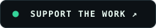
  </a>
  <br>
  <sub>Если проект сэкономил вам время, поддержите его развитие.</sub>
</div>
