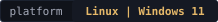

<p align="center">
  
</p>

<h1 align="center">SmartLLM и SmartLLM Studio <code>v0.0.3-beta</code></h1>

<p align="center">
  <b>Локальный офлайн-комбайн для веб-разработки, дизайна и копирайтинга (EN + RU)</b><br>
  Без облачных API · Нулевой дисковый своп · Детерминированный SHA-256 CSP и SEO/GEO-компилятор
</p>

<p align="center">
  <a href="README.md">English</a> | <b>Русский</b>
</p>

<p align="center">
  
  
  
  
</p>

---

## Интерфейс Studio и реальные собранные сайты

<p align="center">
  
  <br><sub><b>SmartLLM Studio</b> (`127.0.0.1:8090`): 5-шаговый Конструктор и Автоматический режим, 20 классических дизайн-канонов с OKLCH-палитрами, живое окно предпросмотра (`1440 / 834 / 390`) и нижний HUD телеметрии GPU/RAM.</sub>
</p>

<table>
  <tr>
    <td align="center" width="50%">
      <br>
      <sub><b>01 · Aether Compute</b> — Авто-режим (`EN`) · <code>Bento Grid</code> · 8 страниц · Ревизия <b>6.0/6</b> · <a href="studio/examples/01_auto_en_aether_compute.md">Промпт</a></sub>
    </td>
    <td align="center" width="50%">
      <br>
      <sub><b>02 · Северный Контур</b> — Авто-режим (`RU`) · <code>Визуальный сторителлинг</code> · 7 страниц · Ревизия <b>6.0/6</b> · <a href="studio/examples/02_auto_ru_sever_arch.md">Промпт</a></sub>
    </td>
  </tr>
  <tr>
    <td align="center" width="50%">
      <br>
      <sub><b>03 · Kuro Specialty Roasters</b> — Конструктор (`EN`) · <code>Микровзаимодействия и тактильный UI</code> · 4 страницы · <b>6.0/6</b> · <a href="studio/examples/03_ctor_en_kuro_roasters.md">Инструкция</a></sub>
    </td>
    <td align="center" width="50%">
      <br>
      <sub><b>Портреты Z-Image 3:4 (<code>576×768</code>)</b> — совпадение пола по имени, запас воздуха над головой (<code>headroom</code>) и точная привязка <code>object-position: 50% 15%</code>.</sub>
    </td>
  </tr>
</table>

---

## Подтверждённые цифры (`RTX 4080 Laptop 12 GB VRAM` + `32 GiB RAM`)

| Показатель | Результат замера | Детали проверки |
|---|---|---|
| **Рабочий чекпойнт** | **`55.01 GiB`** (`K=320/512`, `IQ3_XXS + GSQ Q2_0`) | Доменный прунинг + лечение из `Qwen/Qwen3.8-Flash-Next` (`335.30 GiB` BF16) |
| **Точность квантизации** | **`-65.68%`** L2-ошибки `ffn_down_exps` к стоковому `Q2_0` | `931/931` CUDA-тестов `test-backend-ops` PASS |
| **Скорость генерации** | **`21.14 tok/s`** среднее (`17.502 tok/s` 20-мин 32K soak) | `59` EN+RU запросов длиной до `18,777` токенов |
| **Zero-Swap рантайм** | **`0 B`** дискового свопа · **`0 kB`** PLE в RAM | `26.82 GiB` PLE читается напрямую с NVMe (`O_DIRECT pread`); пик VRAM `9.12 GiB` |
| **HTTP Lighthouse (Suite / Holdout)** | **`100 / 98.2 / 95.6 / 97.6`** · **`100 / 98.8 / 95.2 / 98.0`** | Реальный Chromium + Lighthouse (`P / A / BP / SEO`, `0` unsafe-inline) |
| **Строгий TypeScript** | **`10/10`** Suite + **`8/8`** Holdout тестов PASS | Сборка с `tsc --strict` (`0` `any`) |
| **UI-стенд Studio** | **`232/232`** контролов привязаны · LH **`100 / 100`** | `0` ошибок консоли, `0` внешних запросов, `54` скриншота |

---

## Как устроен конвейер сборки

```text
Бриф пользователя (EN / RU / EN+RU)
  ├─► Авто-режим (10 этапов субагентов поверх дисковой памяти `smartllm.md` + `.smartllm/state.json`)
  │     foundation (единый источник истины) ─► architect (квесты страниц) ─► structure ─► hero ─► copy ─► seo ─► visuals ─► localize ─► review (6/6)
  ├─► Последовательный обмен GPU (`llama-server` -> 0 MiB VRAM -> `sd-cli` Z-Image -> 0 MiB VRAM)
  │     • 6 вариантов логотипа (512×512) и авто-логотип `brand-logo.png`
  │     • Пропорции Z-Image под макет + вертикальные портреты 3:4 (576×768) с проверкой пола
  └─► Детерминированный компилятор (HTML5 + OKLCH `tokens.css` + SHA-256 CSP + JSON-LD `@graph` + `_headers` + `llms.txt`)
```

---

## Пошаговая инструкция

### 0. Всё в одной папке (любая папка, любой диск)

**Требования:** NVIDIA GPU с `>= 12 GB` VRAM (RTX 20–50, драйвер `>= 525`), желательно `32 GB` RAM, Python 3.11+ (на Linux пакет `python3-venv`). **Диск:** `~165 GB` свободно без `--cleanup-parts`; с `--cleanup-parts` пик `~120 GB`, после установки `~85 GB`. Установщик проверяет свободное место ДО закачки и при нехватке останавливается с понятным сообщением.

[`setup_bundle.py`](https://github.com/VKVstudio/SmartLLM/releases/download/v0.0.3-beta/setup_bundle.py) (также в [`scripts/release/`](scripts/release/setup_bundle.py); только stdlib, докачка после обрыва, SHA-256) скачивает ВСЁ из наших GitHub Releases в ОДНУ переносимую папку — `studio/` + `models/` (55 GiB GGUF, сборка из 30 частей + mmproj) + `models/z-image/` (официальный Apache-2.0 `Z-Image-Turbo`: DiT + текстовый энкодер + VAE) + `bin/` переносимые CUDA-движки (Linux glibc >= 2.35 / Windows 11, VC++ redist не нужен). HuggingFace не нужен; опция `--zimage-source hf` — те же официальные веса напрямую из Comfy-Org.

Открой терминал в ЛЮБОЙ папке, где хочешь разместить проект — установщик создаст там папку `SmartLLM`. Конкретный диск или путь не нужны.

**Linux:**
```bash
cd ~   # или любая папка на твой выбор
curl -LO https://github.com/VKVstudio/SmartLLM/releases/download/v0.0.3-beta/setup_bundle.py
python3 setup_bundle.py --cleanup-parts
SmartLLM/studio/bin/smartllm-studio
```

**Windows 11 (PowerShell):**
```powershell
cd $HOME   # или любая папка на любом диске
curl.exe -LO https://github.com/VKVstudio/SmartLLM/releases/download/v0.0.3-beta/setup_bundle.py
python setup_bundle.py --cleanup-parts
SmartLLM\studio\smartllm-studio.bat
```

Затем открой **http://127.0.0.1:8090**. Первый запуск скачивает ~85 GB. Всё лежит внутри папки `SmartLLM` — если какого-то компонента не хватает, Studio покажет баннер «Скачать всё автоматически» (один клик).

### 1. Установка и запуск SmartLLM Studio из исходников (`Linux` и `Windows 11`)

- **Linux (`CachyOS` / Ubuntu / Debian):**
  ```bash
  git clone https://github.com/VKVstudio/SmartLLM.git
  cd SmartLLM/studio
  ./install.sh
  ./bin/smartllm-studio
  ```
- **Windows 11 (`PowerShell`):**
  ```powershell
  git clone https://github.com/VKVstudio/SmartLLM.git
  cd SmartLLM\studio
  powershell -ExecutionPolicy Bypass -File .\install.ps1
  .\smartllm-studio.bat
  ```
  Интерфейс открывается локально по адресу **`http://127.0.0.1:8090`**. Готовые автономные архивы без монорепозитория лежат во вкладке [Releases](https://github.com/VKVstudio/SmartLLM/releases).

### 2. Подключение весов моделей и движков (в окне **Настройки**)

Studio не содержит внутри многогигабайтных весов. В верхней панели открой **Настройки (`Settings`)** и укажи пути к локальным файлам:
1. **GGUF-модель и проектор зрения:** `SmartLLM-v2-K320-V1.gguf` (`55.01 GiB`) + `mmproj-Qwen3.8-Flash-Next-BF16.gguf` (`865.50 MiB`), запуск через **`llama-server`** с `-fit off --lazy-mode direct --n-cpu-moe 42 --moe-cache-mib 2048 --cache-ram 0 -fa on`.
   > Если скачал модель из [Releases](https://github.com/VKVstudio/SmartLLM/releases) по частям (`SmartLLM-v2-K320-V1.gguf.part01`..`part30`, каждая `< 2 GiB`) вместе с `MODEL_SHA256SUMS.txt`, проверь и собери её 1-в-1 скриптом [`reassemble_model.sh`](scripts/release/reassemble_model.sh) (`bash reassemble_model.sh --cleanup`), [`reassemble_model.ps1`](scripts/release/reassemble_model.ps1) или [`reassemble_model.py`](scripts/release/reassemble_model.py).
2. **Генератор визуалов (`sd-cli`):** `stable-diffusion.cpp` с официальными полными весами `z_image_turbo_bf16.safetensors` + `qwen_3_4b.safetensors` + `ae.safetensors` (Apache-2.0, уже в бандле; `--steps 8 --cfg-scale 1.0 --type q8_0 --clip-on-cpu --vae-tiling`).

> В видеопамяти одновременно находится **только одна модель**: Studio сама выгружает `llama-server` перед запуском `sd-cli` и проверяет `0 MiB` compute VRAM на выходе.

### 3. Готовые примеры для первого прогона

Полные промпты и пошаговые гайды лежат в [`studio/examples/`](studio/examples/):
- **Авто EN:** [`01_auto_en_aether_compute.md`](studio/examples/01_auto_en_aether_compute.md) — GPU-облако (`Bento Grid`, 8 страниц)
- **Авто RU:** [`02_auto_ru_sever_arch.md`](studio/examples/02_auto_ru_sever_arch.md) — Архитектурное бюро (`Визуальный сторителлинг`, 7 страниц)
- **Конструктор EN:** [`03_ctor_en_kuro_roasters.md`](studio/examples/03_ctor_en_kuro_roasters.md) — Обжарщик кофе (`Micro-Interactions & Tactile UI`, 4 страницы)

### 4. CLI-комбайн и автономные тесты

- **CLI-комбайн в одну команду:** [`./run_combine.sh`](docs/OFFLINE_COMBINE_QUICKSTART.md)
- **Прогон тестов Studio на CPU (`232` контролов + Chromium/Lighthouse):**
  ```bash
  CUDA_VISIBLE_DEVICES="" .venv_linux/bin/python studio/tests/test_studio_cpu.py
  ```
- **Архитектура и схемы данных:** [`docs/ARCHITECTURE.md`](docs/ARCHITECTURE.md) · [`docs/DATA.md`](docs/DATA.md) · [`eval/suite/`](eval/suite/)

---

## Лицензии

- **Скрипты прунинга, калибровки и бенчмарков:** **[Apache-2.0](LICENSE)**
- **SmartLLM Studio (`studio/`):** Source-available по **[FSL-1.1-ALv2 → Apache-2.0 через 2 года](studio/LICENSE.md)** ([`TRADEMARKS.md`](studio/TRADEMARKS.md), [`OUTPUTS.md`](studio/OUTPUTS.md) — все права на созданные сайты и картинки принадлежат вам, [`THIRD_PARTY_NOTICES.md`](studio/THIRD_PARTY_NOTICES.md)).
- **Веса `SmartLLM v2` GGUF:** поставляются отдельно по `qwen-community-1.0`.
- **Z-Image-Turbo (DiT), текстовый энкодер Qwen3-4B, VAE Flux.1 AE:** **Apache-2.0** (побайтово совпадают с `Comfy-Org/Z-Image-Turbo`; размещены в наших Releases для удобства).
- **Бинарники движков (`llama-server`, `sd-cli`):** MIT-форки `llama.cpp` / `stable-diffusion.cpp` с рантаймом SmartLLM v2 (`--lazy-mode direct`, MoE-кэш, qwen4exp MTP).

Вопросы или заметили неточность: **hello@vkvstudio.com**.

---

<div align="center">
  <a href="DONATE.md">
    
  </a>
  <br>
  <sub>SmartLLM Studio бесплатна. Если проект сэкономил вам время, вы можете поддержать разработку — можно и 0 ₽ (<a href="DONATE.md">DONATE.md</a>).</sub>
</div>
