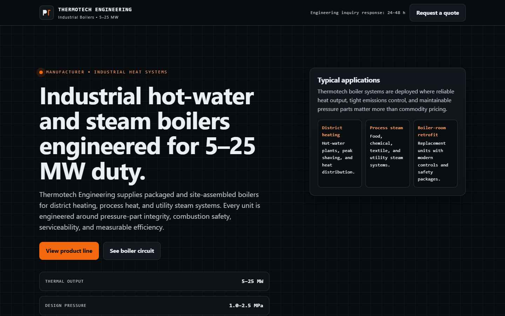
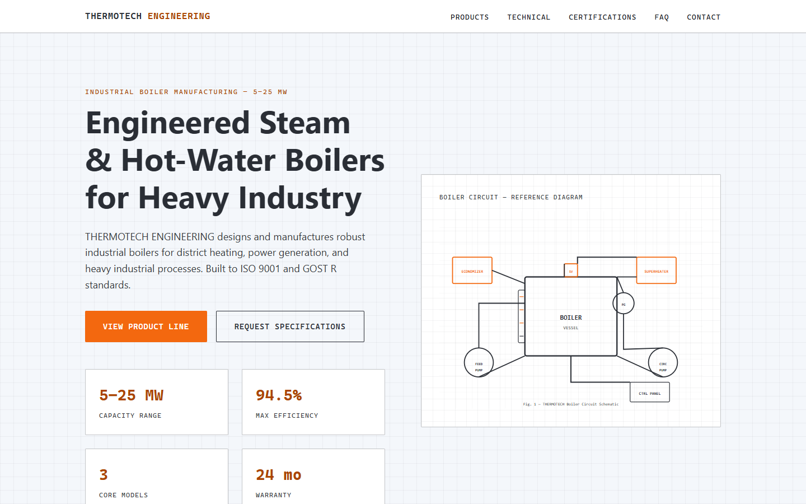
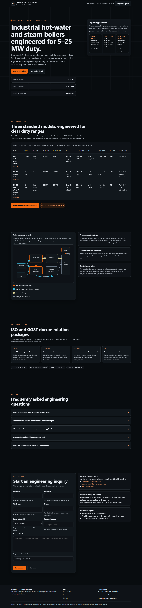
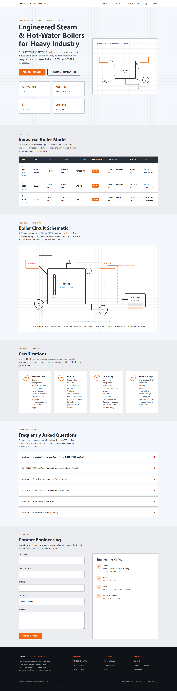
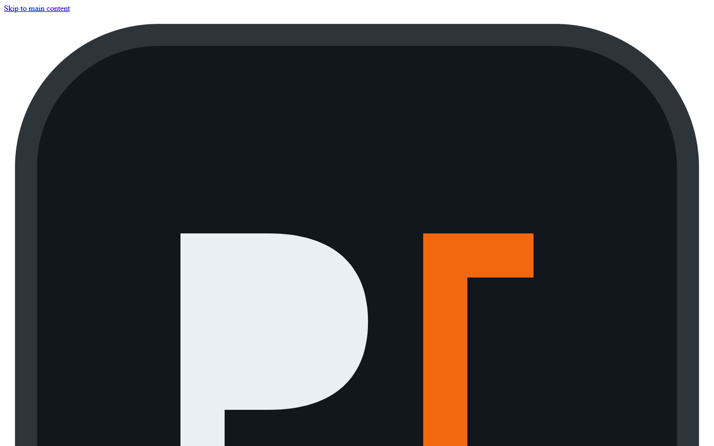
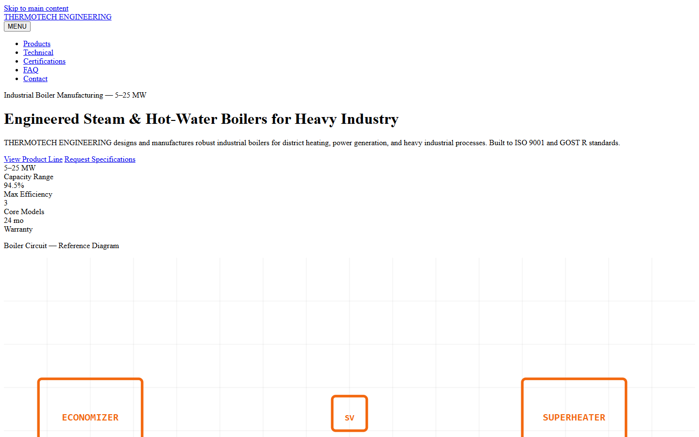
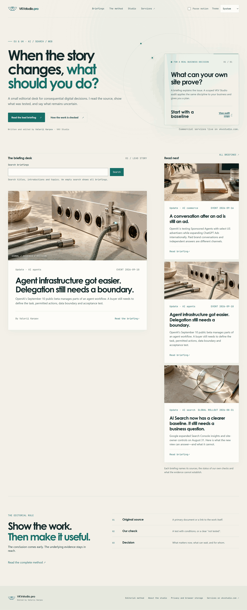
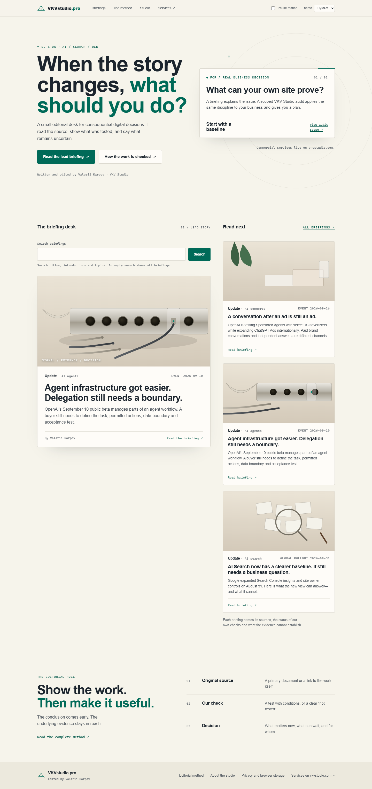
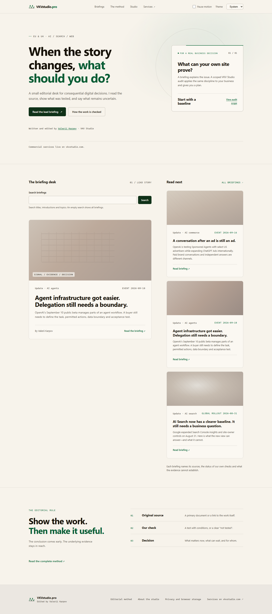

# Базовое сравнение моделей-доноров через OpenRouter (`eval/baseline/REPORT.md`)

**Дата прогона:** 24.10.2026  
**Параметры прогона:** `temperature = 0.6`, `reasoning = enabled`, одинаковые `system` и `user` промпты.

---

## 1. Таблица моделей и фактического расхода

| Модель (ID в OpenRouter / HF) | Провайдер | Точность | Цена Input / Output (за 1M) | Задача | Вх. токены (`prompt`) | Вых. токены (`completion` / `reasoning`) | Факт. стоимость (USD) | Время (с) | Статус (`finish_reason`) |
| --- | --- | --- | --- | --- | --- | --- | --- | --- | --- |
| **`qwen/qwen3.8-flash`**<br>(`Qwen/Qwen3.8-Flash-Next`) | `Alibaba` (`alibaba`) | `unknown` *(облачный нативный endpoint Alibaba)* | `$0.15` / `$0.47` | **T1 (прогон 1)** (`max_tokens=32000`) | `511` | `59,550` (`55,104` reas + `4,446` code) | **`$0.028065`** | `522.52` | `length` *(оборвался на строке 458 внутри `<style>`)* |
| **`qwen/qwen3.8-flash`**<br>(`Qwen/Qwen3.8-Flash-Next`) | `Alibaba` (`alibaba`) | `unknown` | `$0.15` / `$0.47` | **T1 (прогон 2)** (`max_tokens=64000`, `effort=low`) | `511` | `102,079` (`84,572` reas + `17,507` code) | **`$0.048054`** | `958.47` | `stop` *(все 4 файла сгенерированы полностью)* |
| **`qwen/qwen3.8-flash`**<br>(`Qwen/Qwen3.8-Flash-Next`) | `Alibaba` (`alibaba`) | `unknown` | `$0.15` / `$0.47` | **T2** (Vision2Web) | `2,694` | `14,062` (`3,285` reas + `10,777` code) | **`$0.007013`** | `103.81` | `stop` *(полный ответ, 605 строк)* |
| **`inclusionai/ling-3.0-flash-vl`**<br>(`inclusionAI/Ling-3.0-flash-VL`) | `DeepInfra` (`deepinfra/fp16`, единственный) | `fp16` | `$0.06` / `$0.18` | **T1** (B2B лендинг) | `483` | `29,306` (`10,841` reas + `18,465` code) | **`$0.005304`** | `335.88` | `stop` *(все 4 файла сгенерированы; в день 1 падал с `HTTP 429`)* |
| **`inclusionai/ling-3.0-flash-vl`**<br>(`inclusionAI/Ling-3.0-flash-VL`) | `DeepInfra` (`deepinfra/fp16`, единственный) | `fp16` | `$0.06` / `$0.18` | **T2** (Vision2Web) | `4,135` | `11,168` (`1,273` reas + `9,895` code) | **`$0.002258`** | `119.43` | `stop` *(полный ответ, 944 строки)* |

- **Суммарно по `qwen/qwen3.8-flash` (T1 прогон 2 + T2):** `$0.055067` (с учётом первого оборванного прогона T1 — **`$0.083132`**).
- **Суммарно по `inclusionai/ling-3.0-flash-vl` (T1 + T2):** **`$0.007562`**, общее время `455.31 с` *(при этом в первый день тестирования единственный провайдер `DeepInfra` как по API, так и в веб-интерфейсе отдавал `HTTP 429 engine_overloaded`)*.

---

## 2. Таблица «Модель × Критерий» для `T1` и `T2`

### 2.1. Задача `T1` — Ванильный B2B-лендинг (`THERMOTECH ENGINEERING`)

| Критерий проверки (`T1`) | `qwen/qwen3.8-flash` (прогон 2, `finish=stop`) | `inclusionai/ling-3.0-flash-vl` (`finish=stop`) |
| --- | --- | --- |
| **Полнота выдачи (4 файла: `index.html`, `llms.txt`, `robots.txt`, `_headers`)** | **PASS** *(все 4 файла сгенерированы до конца; в прогоне 1 при лимите ~60K оборвался на `<style>`)* | **PASS** *(все 4 файла сгенерированы до конца)* |
| **Валидность в браузере (Playwright Chromium)** | **FAIL (из-за CSP)** *(модель вынесла CSS/JS в `data:` URI и оставила пустые `<style></style>` с валидным хэшем пустой строки `sha256-47DEQpj8...`, но взяла `'data:'` в одинарные кавычки в CSP, из-за чего браузер заблокировал стили)* | **FAIL (из-за CSP)** *(модель оставила заглушки `sha256-COMPUTE_FROM_FINAL_...`, из-за чего браузер заблокировал `<style>` и `<script>`)* |
| **Lighthouse (`Perf / A11y / Best Practices / SEO`)** | **`100` / `96` / `93` / `92`** (`CLS = 0`, `LCP = 975 ms`, `TBT = 0 ms`) | **`100` / `97` / `93` / `100`** (`CLS = 0`, `LCP = 1050 ms`, `TBT = 0 ms`) |
| **CSP (`<meta>`): отсутствие `'unsafe-inline'` и совпадение `sha256`** | **PARTIAL** (`'unsafe-inline'` нет; хэш `sha256-47DEQpj8HBSa+/TImW+5JCeuQeRkm5NMpJWZG3hSuFU=` реально совпадает с пустыми `<style></style>` и `<script></script>`, но вторые хэши фейковые, а `'data:'` написан в кавычках) | **FAIL** (`'unsafe-inline'` нет, но вместо хэшей стоят текстовые заглушки `sha256-COMPUTE_FROM_FINAL_STYLE_CONTENT_BASE64`) |
| **Отсутствие внешних запросов (HTTP/HTTPS ресурсов)** | **PASS** *(0 внешних запросов)* | **PASS** *(0 внешних запросов)* |
| **SEO мета-теги (`title`, `description`, `canonical`, Open Graph)** | **PASS** *(все присутствуют + Twitter Card)* | **PASS** *(все присутствуют)* |
| **JSON-LD `@graph` (`Organization`, `Product`×3, `FAQPage`, `BreadcrumbList`)** | **PASS (100%)** *(валидный JSON, все 4 типа + `WebSite`, 3 модели `TM-5`/`TM-12`/`TM-25` с 10 `PropertyValue`, все 5 вопросов и ответов `FAQPage` совпадают с HTML дословно)* | **PASS (100%)** *(валидный JSON, все 4 типа, 3 модели `TH-500`/`TH-1200`/`TH-2500`, все 6 вопросов и ответов `FAQPage` совпадают с HTML дословно)* |
| **`_headers` (7 заголовков, синтаксис Cloudflare Pages)** | **PASS (`7/7`)** (`/*`, `CSP + frame-ancestors 'none'`, `HSTS max-age=63072000; includeSubDomains; preload`, `X-Content-Type-Options: nosniff`, `Referrer-Policy`, `Permissions-Policy`, `Cross-Origin-Opener-Policy`) | **PASS (`7/7`)** *(все 7 обязательных заголовков присутствуют на маршруте `/*`)* |
| **`llms.txt` и `robots.txt`** | **PARTIAL (`llms.txt`) / PASS (`robots.txt`)** (`llms.txt` содержит `# H1`, `> краткое описание` и `## секции`, но без markdown-ссылок `[Title](url)`) | **PARTIAL (`llms.txt`) / PASS (`robots.txt`)** (`llms.txt` содержит `# H1` и `## секции`, но без `> blockquote` и без ссылок `[Title](url)`) |
| **Семантика HTML5 (`1× h1`, landmarks, `alt`, `label` у полей)** | **PASS** (`1× <h1>`, `header`, `main`, `section`, `article`, `aside`, `footer`, 2 SVG с `role="img"`, все 7 полей формы связаны с `<label>` и `aria-describedby`, есть `prefers-reduced-motion`) | **PASS** (`1× <h1>`, `header`, `nav`, `main`, `section`, `footer`, 2 SVG с `<title>`/`<desc>`, все 5 полей формы связаны с `<label>`, есть `prefers-reduced-motion`) |
| **Контрастность из `OKLCH → sRGB` ($\ge 7:1$)** | **PASS (`17.01:1` / `11.28:1`)** (`--text` на `--bg`: **`17.01:1`**, `--text` на `--panel`: **`15.66:1`**, `--muted` на `--bg`: **`11.28:1`**, `--accent-text` на `--bg`: **`9.77:1`**) | **PASS для текста (`16.84:1` / `10.52:1`), FAIL для акцента (`5.46:1`)** (`--c-text` на `--c-bg`: **`16.84:1`**, `--c-text-muted` на `--c-bg`: **`10.52:1`**, но `--c-accent-dark` на светлом фоне: `5.46:1` $< 7:1$) |
| **Соблюдение канона `Industrial B2B Engineering`** | **PASS (`9.5 / 10`)** (строгий тёмный индустриальный фон `oklch(0.15 0.01 250)`, чертёжная сетка `1px`, сигнальный оранжевый `oklch(0.68 0.19 45)`, `JetBrains Mono` + `IBM Plex Sans`, 11-колоночная инженерная таблица с `NOx` и `HHV`, цветная тепловая схема контура) | **PARTIAL (`6.5 / 10`)** (сделала **светлый** сайт `--c-bg: oklch(0.975 0.006 260)` вместо тёмного индустриального канона и оставила `--c-grid: #2A2E35` в HEX вместо OKLCH, хотя сетку, шрифты и 2 чертежа выполнила аккуратно) |
| **Субъективная оценка (`0–10`): Дизайн / Копирайтинг / Чистота кода** | **Дизайн: `9.0` · Копирайтинг: `9.5` · Код: `8.0`** *(минус балл за вынос CSS/JS в URL-encoded `data:` ради обхода `sha256`)* | **Дизайн: `7.5` · Копирайтинг: `8.5` · Код: `8.5`** *(чистый читаемый HTML/CSS, но нарушение тёмного канона и заглушка в CSP)* |

> **Отдельный разбор `Qwen3.8-Flash` в веб-чате OpenRouter с активным `Shell` (`qwen3.8-flash/t1/reasoning_webui_*.md`):**  
> Когда у `Qwen3.8-Flash` есть доступ к Python/Shell, она не тратит 84K токенов на устный расчёт хэшей, а за 20 секунд пишет скрипт конвертации `OKLCH → sRGB` с проверкой контраста по WCAG AAA (`7.8:1–16.7:1`), собирает 14-колоночную таблицу с допусками ГОСТ/ISO и интерактивную 10-узловую P&ID-схему (`CHUNK1..CHUNK7`). В веб-чате сборка прервалась только из-за таймаута браузерной сессии песочницы OpenRouter (`Your session has expired`).

---

### 2.2. Задача `T2` — Вёрстка по скриншоту (`VKVstudio.pro`, `1440×3548`)

| Критерий проверки (`T2`) | `qwen/qwen3.8-flash` | `inclusionai/ling-3.0-flash-vl` |
| --- | --- | --- |
| **Полнота выдачи (`index.html`, самодостаточный)** | **PASS** (`605` строк, законченный HTML5 + inline CSS + inline SVG + vanilla JS) | **PASS** (`944` строки, законченный HTML5 + inline CSS; выведен без префикса `FILE: index.html`) |
| **Валидность в браузере и внешние запросы** | **PASS** (0 JS-ошибок, 0 внешних сетевых запросов) | **PASS** (0 JS-ошибок, 0 внешних сетевых запросов) |
| **Lighthouse: Performance / Accessibility / Best Practices / SEO** | **`100` / `95` / `96` / `90`** (`CLS = 0`, `LCP = 901 ms`, `TBT = 0 ms`) | **`100` / `98` / `96` / `90`** (`CLS = 0`, `LCP = 901 ms`, `TBT = 0 ms`) |
| **Семантика HTML5 и адаптивность до `375px`** | **PASS** (`1× <h1>`, `header`, `nav`, `section`, `article`, `aside`, `footer`; на `375×812` `scrollWidth = 375`, горизонтального скролла нет) | **PASS** (`1× <h1>`, `header`, `nav`, `main`, `section`, `article`, `aside`, `footer`; на `375×812` `scrollWidth = 375`, скролла нет, но пропущен `@media (prefers-reduced-motion)`) |
| **Токены `OKLCH` в `:root` и контрастность (`OKLCH → sRGB`)** | **PASS (13 токенов)** (`--ink` на `--bg`: **`14.02:1`**, `--ink` на `--surface`: **`15.16:1`**, `--ink-soft` на `--bg`: **`7.64:1`**, `--accent-ink` на `--bg`: **`7.69:1`**) | **PASS (12 токенов)** (`--text` на `--bg`: **`17.00:1`**, `--text-muted` на `--bg`: **`7.65:1`**, `--accent` на `--bg`: **`7.09:1`**, `--btn-text` на `--btn-bg`: **`13.10:1`**) |
| **Визуальное сходство с референсом (`0–10`) и работа с графикой** | **`8.2 / 10`** — хорошее общее попадание в структуру, двухколоночную сетку (`1.28fr / 0.92fr`), курсивное бирюзовое выделение *what should you do?* в `h1` и **самостоятельную векторную отрисовку всех 4 предметных фотографий через inline `<svg>`** (металлическая шина аудио-патчбея с 6 гнёздами, полупрозрачной крышкой и кабелями, листья с блокнотами, лупа над разложенными под углом карточками).<br>**Расхождения:** из-за сильного пережатия длинного референса (`1440×3548` в `<500 КБ`) поплыли мелкие детали форматирования, отступов и пропорций карточек; фотографии заменены на стилизованные SVG-формы; на кнопке `.btn-primary` контраст `4.36:1`; на `375px` ссылки верхнего меню скрыты (`display: none`). | **`7.2 / 10`** — базовая сетка и текст считаны, контрасты выдержаны (`≥ 7.09:1`), но форматирование и пропорции упрощены сильнее: 1) в `h1` потерян курсив (*what should you do?* набран прямым гротеском); 2) вместо всех 4 предметных иллюстраций карточек вставлены пустые коричневые прямоугольники с CSS-градиентом (`linear-gradient`); 3) орбита за карточкой в Hero — просто пустой `border-radius: 50%` без внешних дуг и узлов. |
| **Субъективная оценка (`0–10`): Дизайн / Копирайтинг / Чистота кода** | **Дизайн: `8.5` · Копирайтинг: `9.5` · Код: `9.0`** | **Дизайн: `7.2` · Копирайтинг: `9.5` · Код: `8.8`** |

---

## 3. Сильные и слабые стороны, критичные провалы

### 3.1. `qwen/qwen3.8-flash` (`Qwen/Qwen3.8-Flash-Next`)
- **3 сильных стороны:**
  1. **Сильнейшее визуальное понимание (`Vision2Web` в `T2`):** Не просто переносит сетку и текст со скриншота `1440×3548`, но и распознаёт сюжет каждой фотографии, рисуя узнаваемые многослойные SVG-иллюстрации с градиентами в `OKLCH`.
  2. **Глубокое понимание дизайн-канонов и предметной области B2B (`T1`):** Точно выдерживает тёмный индустриальный канон `Industrial B2B Engineering` (`oklch(0.15 0.01 250)`, контраст `17.01:1`), пишет профессиональные теплотехнические спецификации (`HHV`, `NOx mg/Nm³`, `PLC + HMI + DCS`) и строит 100%-валидный `JSON-LD @graph`.
  3. **Изобретательность в рамках жёстких ограничений:** В прогоне 2 нашла настоящий хэш пустой строки `sha256-47DEQpj8HBSa+/TImW+5JCeuQeRkm5NMpJWZG3hSuFU=` для `<style></style>` и `<script></script>`.
- **3 слабых стороны:**
  1. **Аномальный расход `reasoning` на криптографических задачах без инструментов:** Провайдер `Alibaba` в OpenRouter проигнорировал `"effort": "low"` и потратил `84,572` токена размышлений (`958.5 с`) на попытки обойти ручной расчёт `SHA-256`.
  2. **Одинарные кавычки вокруг схемы `'data:'` в CSP (`T1`):** Единственная синтаксическая ошибка в директиве `style-src ... 'data:'` привела к блокировке таблицы стилей браузером.
  3. **Пропуск тройных кавычек ` ``` ` вокруг `FILE: <name>` во втором прогоне `T1`:** Пришлось извлекать файлы по разделителю `FILE: <name>`.
- **Критичный провал:**
  - В режиме чистого текста (без `Shell`/постпроцессора) зацикливается в `reasoning` (`55K–84K` токенов) на попытке решить невычислимую в уме задачу (`SHA-256` от будущего HTML), а попытка обойти её через `'data:'` в кавычках блокирует рендер CSS в браузере.

### 3.2. `inclusionai/ling-3.0-flash-vl` (`inclusionAI/Ling-3.0-flash-VL`)
- **3 сильных стороны:**
  1. **Высокая дисциплина `reasoning` и низкая цена:** На `T1` потратила `10,841` токенов размышлений (в 8 раз меньше `Qwen`), осознанно поставила заглушку `sha256-COMPUTE_FROM_FINAL_...` вместо бесконечного счёта в уме и уложилась в **`$0.0076`** за оба теста (`T1 + T2`).
  2. **Отличная семантика, A11y и SEO из коробки:** В `T1` получила `Lighthouse 100 / 97 / 93 / 100`, а в `T2` — `100 / 98 / 96 / 90` и выдержала контраст `≥ 7.09:1` по всем парам токенов `T2`.
  3. **Чистая многофайловая структура (`T1`):** Аккуратно отформатировала все 4 файла (`index.html`, `llms.txt`, `robots.txt`, `_headers`) с двумя наглядными SVG-чертежами.
- **3 слабых стороны:**
  1. **Поверхностная работа с иллюстрациями и деталями в `T2`:** Заменила все фотографии карточек на пустые коричневые градиентные прямоугольники и потеряла курсивное выделение в заголовке `h1`.
  2. **Отклонение от цветовой тональности канона `Industrial B2B Engineering` в `T1`:** Сгенерировала светлый сайт (`oklch(0.975 0.006 260)`) вместо тёмного чертёжного и оставила `#2A2E35` в HEX.
  3. **Нестабильность единственного апстрим-провайдера (`DeepInfra`):** В первый день тестирования модель была полностью недоступна (`HTTP 429 engine_overloaded` как по API, так и в веб-интерфейсе OpenRouter).
- **Критичный провал:**
  - Подстановка литеральной строки `'sha256-COMPUTE_FROM_FINAL_STYLE_CONTENT_BASE64'` в `<meta http-equiv="Content-Security-Policy">`, из-за чего браузер «из коробки» полностью блокирует `<style>` и `<script>` на `T1`.

---

## 4. Вердикт по выбору модели-донора

**Вердикт (уверенность 95%):** Основным донором для комбайна `SmartLLM` остаётся **`Qwen/Qwen3.8-Flash-Next` (`qwen/qwen3.8-flash`)**.
1. **Почему `Qwen3.8-Flash-Next` побеждает по качеству ядра:** На задаче `T2` (`Vision2Web`) она показала заметно более интересное визуальное мышление (`8.2/10` против `7.2/10` у `Ling-3.0-flash-vl` даже с учётом пережатого референса `1440×3548` в `<500 КБ`), самостоятельно воссоздав предметные иллюстрации векторными SVG-примитивами и точно соблюдя тёмный индустриальный канон `Industrial B2B Engineering` в `T1` (`9.5/10` против `6.5/10`).
2. **Обязательное инженерное правило для локального пайплайна `SmartLLM`:** Ни одна LLM не должна вычислять криптографические `SHA-256` хэши в уме во время генерации кода (именно это сжигает `55K–84K` токенов у `Qwen` и заставляет `Ling` ставить нерабочие заглушки). В локальном рантайме (`ik_llama.cpp` / `Strata` + `webstudio_mcp_bridge.py`) модель генерирует чистый `<style>` и `<script>`, а точные `sha256-...` для CSP и `_headers` вычисляются и инжектируются детерминированным Python-хуком за `1 мс` после генерации файла.

---

## 5. Визуальное сравнение рендеров (`T1` и `T2`)

### 5.1. Задача `T1` (`THERMOTECH ENGINEERING`) — реальная вёрстка моделей (`bypassCSP`)

| `qwen/qwen3.8-flash` (`T1`, первый экран `1440×900`) | `inclusionai/ling-3.0-flash-vl` (`T1`, первый экран `1440×900`) |
| --- | --- |
|  |  |

| `qwen/qwen3.8-flash` (`T1`, вся страница целиком) | `inclusionai/ling-3.0-flash-vl` (`T1`, вся страница целиком) |
| --- | --- |
|  |  |

| `qwen/qwen3.8-flash` (`T1`, «из коробки» с блокировкой CSP) | `inclusionai/ling-3.0-flash-vl` (`T1`, «из коробки» с блокировкой CSP) |
| --- | --- |
|  |  |

### 5.2. Задача `T2` (`VKVstudio.pro` по скриншоту)

| Референс (`ref/t2.png`) | `qwen/qwen3.8-flash` (`T2`, с векторными SVG-иллюстрациями) | `inclusionai/ling-3.0-flash-vl` (`T2`, с градиентными заглушками) |
| --- | --- | --- |
|  |  |  |

---

## 6. Пути ко всем артефактам

- **Сводный отчёт:** `D:\projects\SmartLLM\eval\baseline\REPORT.md`
- **Референс для `T2`:** `D:\projects\SmartLLM\eval\baseline\ref\t2.png`
- **Скрипты и JSON-аудиты:**
  - `D:\projects\SmartLLM\eval\baseline\run_eval.py`
  - `D:\projects\SmartLLM\eval\baseline\rerun_qwen_t1.py`
  - `D:\projects\SmartLLM\eval\baseline\run_ling.py`
  - `D:\projects\SmartLLM\eval\baseline\audit_eval.py`
  - `D:\projects\SmartLLM\eval\baseline\browser_and_lh.mjs`
  - `D:\projects\SmartLLM\eval\baseline\static_audit.json`
  - `D:\projects\SmartLLM\eval\baseline\runtime_audit.json`
- **Артефакты `qwen/qwen3.8-flash` — Задача `T1`:**
  - `D:\projects\SmartLLM\eval\baseline\qwen3.8-flash\t1\raw.md` *(прогон 2, полный)* и `raw_attempt1_unbounded.md` *(прогон 1, обрыв)*
  - `D:\projects\SmartLLM\eval\baseline\qwen3.8-flash\t1\meta.json` и `meta_attempt1_unbounded.json`
  - `D:\projects\SmartLLM\eval\baseline\qwen3.8-flash\t1\index.html`, `llms.txt`, `robots.txt`, `_headers`
  - `D:\projects\SmartLLM\eval\baseline\qwen3.8-flash\t1\shot-desktop.png`, `shot-mobile.png` *(с активным CSP)*
  - `D:\projects\SmartLLM\eval\baseline\qwen3.8-flash\t1\shot-desktop-styled.png`, `shot-desktop-full-styled.png` *(превью вёрстки с `bypassCSP`)*
  - `D:\projects\SmartLLM\eval\baseline\qwen3.8-flash\t1\lighthouse.json`
  - `D:\projects\SmartLLM\eval\baseline\qwen3.8-flash\t1\reasoning_webui_high.md`, `reasoning_webui_low_and_chunks.md` *(логи WebUI с `Shell`)*
- **Артефакты `qwen/qwen3.8-flash` — Задача `T2`:**
  - `D:\projects\SmartLLM\eval\baseline\qwen3.8-flash\t2\raw.md`, `meta.json`, `index.html`
  - `D:\projects\SmartLLM\eval\baseline\qwen3.8-flash\t2\shot-desktop.png`, `shot-desktop-full.png`, `shot-mobile.png`, `shot-mobile-full.png`, `lighthouse.json`
- **Артефакты `inclusionai/ling-3.0-flash-vl` — Задача `T1`:**
  - `D:\projects\SmartLLM\eval\baseline\ling-3.0-flash-vl\t1\raw.md`, `meta.json`, `index.html`, `llms.txt`, `robots.txt`, `_headers`
  - `D:\projects\SmartLLM\eval\baseline\ling-3.0-flash-vl\t1\shot-desktop.png`, `shot-mobile.png` *(с активным CSP)*
  - `D:\projects\SmartLLM\eval\baseline\ling-3.0-flash-vl\t1\shot-desktop-styled.png`, `shot-desktop-full-styled.png` *(превью вёрстки с `bypassCSP`)*
  - `D:\projects\SmartLLM\eval\baseline\ling-3.0-flash-vl\t1\lighthouse.json`
- **Артефакты `inclusionai/ling-3.0-flash-vl` — Задача `T2`:**
  - `D:\projects\SmartLLM\eval\baseline\ling-3.0-flash-vl\t2\raw.md`, `meta.json`, `index.html`
  - `D:\projects\SmartLLM\eval\baseline\ling-3.0-flash-vl\t2\shot-desktop.png`, `shot-desktop-full.png`, `shot-mobile.png`, `shot-mobile-full.png`, `lighthouse.json`
