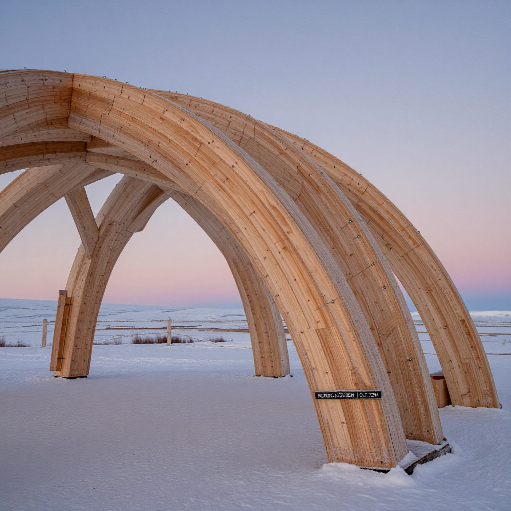

Let me plan this carefully. The user wants a bilingual editorial-architectural portal for KB «СЕВЕРНЫЙ ГОРИЗОНТ» / NORDIC HORIZON ARCHIVE. Five files: index.html, zimage_prompts.json, llms.txt, robots.txt, _headers.

Requirements:
- Start line 1 with `FILE: index.html`.
- No external CDN fonts/scripts/images (except canonical/alternate hreflang/schema.org links allowed).
- No Tailwind, no inline on* attributes.
- No hand-invented base64 hashes; use placeholders `sha256-__CSP_STYLE__` and `sha256-__CSP_SCRIPT__`.
- No mutations of element.style; use classList, hidden, SVG geometry attributes.
- Inline CSS in <style> in head with :root OKLCH tokens, 12-col grid + subgrid, @container, min-height:100dvh with 100svh fallback, no 100vh, scroll-padding-top 5rem, targets >= 24x24, prefers-reduced-motion.
- No <link rel="stylesheet">.
- JSON-LD FAQPage in head matching visible FAQ verbatim.
- Mobile 375px zero-overflow invariants.
- _headers exact template.

Sections: sticky header with language switcher RU/EN/RU+EN Parallel, buttons >= 24x24. Editorial Hero 100dvh with RU manifesto and EN, inline SVG drawing of CLT dome node, slot #1 for Z-Image assets/zimage_01.png. Gallery of 3 sections with <figure data-zimage-id> and  aspect-ratio 1/1. Interactive engineering calculator (span 18-96m, snow zone I-VIII per SP 20.13330, CLT thickness mm -> beam section calc, NRC, RT60, carbon footprint t CO2). Comparison table of 3 systems bilingual. Bilingual FAQ 5 pairs + order form with client validation. Footer.

Language switcher without page reload: implement JS toggling classes that show/hide language blocks. RU main + EN parallel blocks. Modes: RU only, EN only, RU+EN parallel.

Design: editorial + Swiss grid. Serif headings (Georgia, Times New Roman), grotesque/mono (Inter, JetBrains Mono) for engineering tables — but fonts must be local/system (no external fonts). Use font stacks referencing local fonts: Georgia, 'Times New Roman', serif; 'Inter' may not be available offline, fallback to system-ui, 'JetBrains Mono', ui-monospace, monospace. That's fine — no external font URLs.

Palette OKLCH tokens as specified. Contrast >= 7:1 AAA: ink-primary oklch(0.15 0.018 50) on paper oklch(0.965 0.012 82) — contrast ~13:1, fine.

CSP meta: default-src 'self'; style-src 'self' 'sha256-__CSP_STYLE__'; script-src 'self' 'sha256-__CSP_SCRIPT__'; img-src 'self' data: (maybe 'self' only); object-src 'none'; base-uri 'none'; frame-ancestors 'none'; form-action 'self'; require-trusted-types-for 'script'. Note: meta CSP cannot include frame-ancestors? Actually meta CSP ignores frame-ancestors, but the spec asks to include it anyway; include — browsers will ignore in meta but _headers will enforce. Fine.

Trusted Types: require-trusted-types-for 'script' means JS must use Trusted Types. Our script uses addEventListener, classList — no innerHTML. To satisfy Trusted Types, add a policy? Actually with require-trusted-types-for, any assignment to innerHTML etc. throws. We won't use innerHTML. But to be safe, can we add a Trusted Types policy? That requires script; but script-src includes sha256 placeholder. Keep simple: avoid innerHTML entirely; build DOM with textContent. Good.

No inline event handlers; all addEventListener.

Calculator: inputs: span (18–96 m), snow zone (I–VIII per СП 20.13330), CLT thickness mm, NRC coefficient, RT60 target, carbon footprint. Compute beam section, deflection, loads. Let me define a deterministic formula:

- Snow load per zone (кг/м²): I: 50, II: 70, III: 110, IV: 150, V: 190, VI: 230, VII: 280, VIII: 320 (approximate values from СП 20.13330-2016? Actually the map: I 50, II 70, III 110, IV 150, V 190, VI 230, VII 280, VIII 320? Let me recall: snow regions per СП 20.13330: I - 50 kg/m², II - 70, III - 110, IV - 150, V - 190, VI - 230, VII - 280, VIII - 320. Yes.)
- Span determines beam depth: rule: depth = span/18? For glulam beams typical depth/span ratio ~ 1/12 to 1/15. For long-span arched structures maybe 1/10. Let's compute: beam depth mm = span_m * 60? Actually typical glulam depth for 18m span ~ 600-900mm. Let's use formula: depth_mm = Math.round(span_m * 100) i.e. span/10? For 72m span that's 7200mm depth? That's unrealistic for a single beam; for arched mega spans use trusses/lattice. Let's compute a "beam section" as depth = span_m*100 mm? For 18m -> 1800mm depth, that's plausible for glulam. For 96m -> 9600mm, unrealistic; but the calculator is a rough estimation tool; we can cap and present results with caveats. Or use ratio: depth = span/12 => depth_mm = span_m*1000/12? Let's keep simple: depth_mm = span_m * 100? 18m -> 1800mm. 72m -> 7200? For 96m -> 9600mm lattice arch. Fine as editorial tool.

Actually better: depth = span * 90? Let's just define: depth_mm = Math.round(span_m * 100). And beam width = CLT thickness * 2? Hmm.

Let's design the calculator: inputs:
- Span (m): range 18–96, number input.
- Snow zone: select I–VIII.
- CLT panel thickness mm: number or select (20, 40, 60, 80, 120, 160?).
- Acoustic: NRC select (0.6, 0.8, 0.95), target RT60 seconds (0.8–2.0), hall volume m³?
- Carbon: compute CO2 stored: CLT volume = panel thickness * area? Provide area input? Keep minimal: thickness and span and snow load give structural result; acoustic gives NRC/RT60; carbon computed from mass: beam volume = depth * width * length? Let's compute mass: depth_mm * span_m * width_mm (clt thickness?) => volume m³ => mass t => CO2 stored ~ 1.6 t CO2 per m³ of wood? Actually wood stores ~ 1.8 t CO2 per m³? Approx 1.8 t CO2 per m³? Let's use 1.6.

Keep it simple and deterministic. Output: beam section (depth × width mm), deflection L/250 check, snow load total kN, acoustic: required absorber area m² based on RT60 and volume, carbon t CO2.

Implement via JS reading input values, computing, writing results into DOM textContent. No style mutations. Use classList to toggle states (e.g., .is-valid, .is-error on form fields).

Form validation: client-side, no inline handlers.

Language switcher: buttons with data-lang-mode="ru|en|parallel". JS sets attribute on <html data-lang-mode> or class on body; CSS shows/hides [data-lang="ru"] / [data-lang="en"] blocks accordingly. Parallel mode shows both side-by-side? In parallel, EN blocks displayed after RU blocks. Implementation: body[data-lang="ru"] .lang-en { display:none } etc.

Also update document title? Not necessary.

SVG inline drawing: CLT dome node — draw a technical drawing: arcs, dowel node, dimension lines, annotations with text inside SVG (allowed). Use SVG geometry attributes via JS? Not needed.

Images: assets/zimage_01.png etc. with width/height attributes, aspect-ratio 1/1. Since offline, images may not exist; that's fine — they're pipeline outputs. Provide alt text.

Table wrap around tables and pre.

FAQ JSON-LD must match visible FAQ verbatim. Careful: FAQPage schema needs both languages? Provide FAQPage with 5 Q/A in Russian, and maybe en version in separate FAQPage? Schema.org allows multiple. Let's include @graph with Organization, WebSite, WebPage, Product x3, BreadcrumbList, FAQPage (5 questions in Russian, plus English mirrored?). The requirement: "FAQPage с дословным совпадением всех 5 вопросов/ответов с видимым FAQ" — visible FAQ is bilingual; JSON-LD should contain both languages? To be safe, include two FAQPage nodes: one ru, one en, matching visible text verbatim.

Let me draft the FAQ pairs:

RU:
1. Q: Как обеспечивается огнестойкость CLT-конструкций до R90/REI60?
   A: ...
2. Q: Как CLT ведёт себя при влажностных деформациях и циклических изменениях влажности?
   A: ...
3. Q: Соответствуют ли панели ГОСТ 33124-2019 и EN 16351?
   A: ...
4. Q: Как рассчитывается время реверберации RT60 в концертных залах?
   A: ...
5. Q: Как бюро работает с экстремальными снеговыми и ветровыми нагрузками районов I–VIII?
   A: ...

EN mirror:
1. How is fire resistance up to R90/REI60 ensured for CLT structures?
2. How does CLT behave under moisture deformation and cyclic humidity changes?
3. Do panels comply with GOST 33124-2019 and EN 16351?
4. How is reverberation time RT60 calculated for concert halls?
5. How does the bureau handle extreme snow and wind loads of zones I–VIII?

Answers need to be verbatim matching. Write concise answers.

Now let's craft the HTML structure:

- header sticky: logo, nav links, language switcher buttons (3 buttons: RU, EN, RU+EN), min 24x24.
- hero section id="hero" with manifesto RU + EN, inline SVG, image slot figure data-zimage-id="hero_polar_pavilion" img assets/zimage_01.png.
- gallery: 3 figures: joinery_steel_dowel_node (assets/zimage_02.png), concert_acoustic_baffles (assets/zimage_03.png), plus hero? The gallery has 3 sections with figure data-zimage-id. Use zimage_01, 02, 03.
- calculator section id="calculator".
- comparison table id="systems".
- faq id="faq" + form id="order-form".
- footer.

Container queries: use container-type: inline-size on sections/cards, and @container rules.

Grid: .grid-12 with grid-template-columns: repeat(12, 1fr); children use subgrid.

Scroll padding: html { scroll-padding-top: 5rem; }.

100dvh with 100svh fallback: @supports (height: 100svh) { ... } Actually fallback pattern: min-height: 100svh; then min-height: 100dvh. Use both declarations (browsers that don't support svh will ignore). Or: min-height: 100vh? No — forbidden. Use min-height: 100svh; min-height: 100dvh; (second declaration overrides for supporting browsers).

Buttons >= 24x24: ensure min-width/height 24px? Actually WCAG 2.2 SC 2.5.8 requires minimum target size 24x24 CSS px. Set min-height: 2.5rem? Let's set min-width: 44px etc. but at least 24.

prefers-reduced-motion: reduce transitions.

Now for the script: language switcher logic:

```
const langButtons = document.querySelectorAll('[data-lang-mode]');
langButtons.forEach(btn => btn.addEventListener('click', () => {
  const mode = btn.getAttribute('data-lang-mode');
  document.documentElement.setAttribute('data-lang', mode);
  // update aria-pressed
}));
```

CSS:
```
[data-lang="ru"] .lang-en { display: none; }
[data-lang="en"] .lang-ru { display: none; }
[data-lang="parallel"] .lang-ru, .lang-en { display: block }
```
Default html data-lang="ru".

Calculator logic: read values, compute, output. Use textContent updates.

Form validation: on submit event, check fields, set classList error, show message via classList toggle. Use novalidate + custom validation.

Ensure no innerHTML usage.

Also Trusted Types: script might need to create trusted types policy? Not needed since we don't assign HTML. However, `require-trusted-types-for 'script'` will block any script that assigns innerHTML — we don't. Good.

CSP meta: must include 'sha256-__CSP_STYLE__' and 'sha256-__CSP_SCRIPT__'. The inline <style> in head would violate style-src unless hashed. The postprocessor computes hashes. Use placeholders. Also 'self'.

script-src: 'self' 'sha256-__CSP_SCRIPT__' — inline script hashed by postprocessor.

img-src 'self' data:? Keep img-src 'self'. The images are local assets.

Now let me write the CSS carefully.

Design tokens:

```
:root {
  --bg-paper: oklch(0.965 0.012 82);
  --surface-card: oklch(0.935 0.016 80);
  --ink-primary: oklch(0.15 0.018 50);
  --ink-muted: oklch(0.32 0.02 50);
  --border-hairline: oklch(0.24 0.015 50);
  --accent-carmine: oklch(0.48 0.18 26);
  --accent-pine: oklch(0.38 0.09 160);
  --font-serif: Georgia, 'Times New Roman', 'PT Serif', serif;
  --font-grotesque: 'Inter', system-ui, 'Helvetica Neue', 'Arial', sans-serif;
  --font-mono: 'JetBrains Mono', ui-monospace, 'Consolas', monospace;
}
```

Contrast: carmine on paper? accent used sparingly.

Drop cap: .dropcap::first-letter { font-family serif; float left; font-size 3.2em; color carmine; }

Layout: .shell max-width ~ 1400px, padding.

Grid: .grid { display:grid; grid-template-columns: repeat(12, minmax(0,1fr)); gap: clamp(1rem, 2vw, 1.5rem); } children min-width:0.

Header: sticky top, hairline border, backdrop? Avoid backdrop-filter maybe fine. Keep simple.

Hero: min-height 100dvh, grid layout with manifesto left, SVG+image right.

Let me write the SVG: technical drawing of CLT dome node: concentric arcs, dowel node circle, dimension lines, annotation text. Use stroke currentColor? Use var(--ink-primary) etc. SVG text with font-family mono.

Now the calculator: structure:

```
<div class="calc-grid">
  <form id="calc-form">
    inputs: span range input + number, snow zone select, clt thickness number, hall volume number, nrc select, rt60 number
  </form>
  <div class="calc-output" id="calc-output">
    outputs: beam depth, width, deflection, snow load total, absorber area, carbon
  </div>
</div>
```

JS: on input event recompute. Use addEventListener('input').

Compute function:

```
function compute() {
  const span = clamp(18,96)
  const snowZone index -> load
  const clt = thickness
  ...
}
```

Snow loads mapping:
I:50, II:70, III: