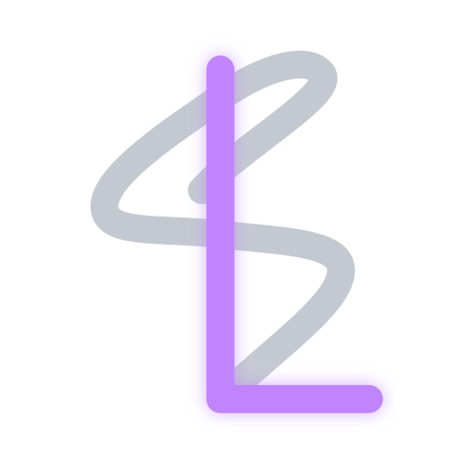
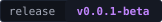
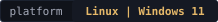
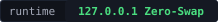
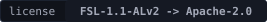
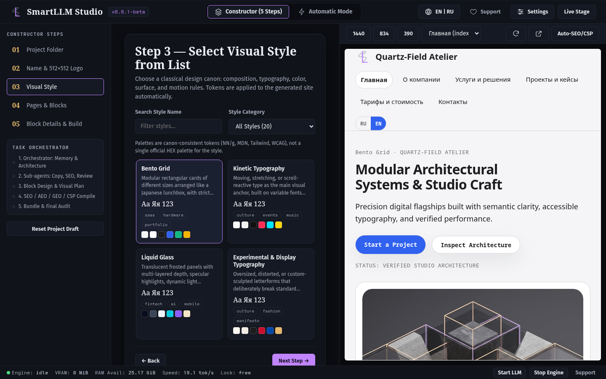
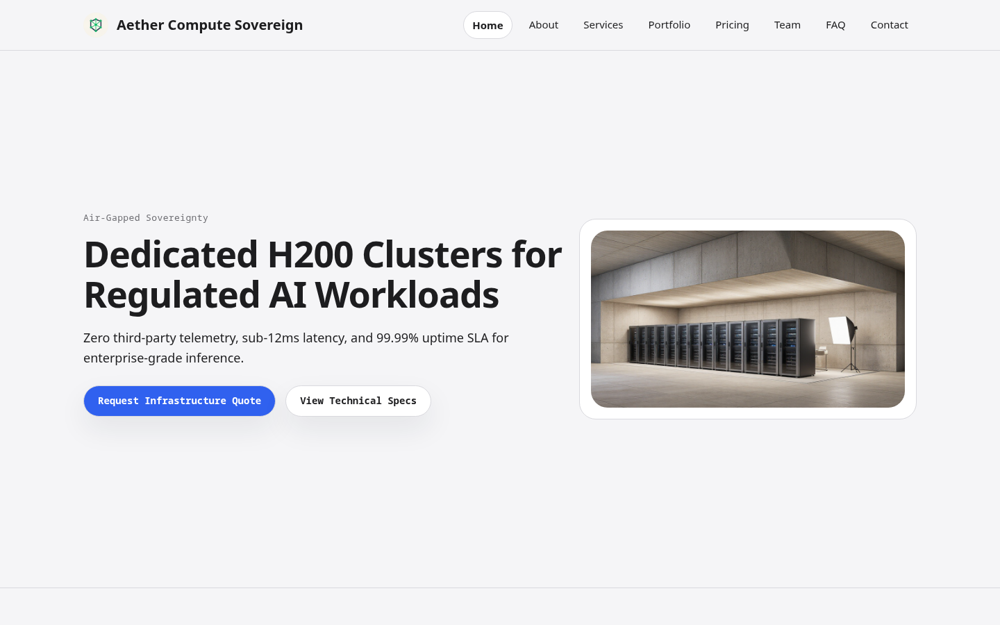
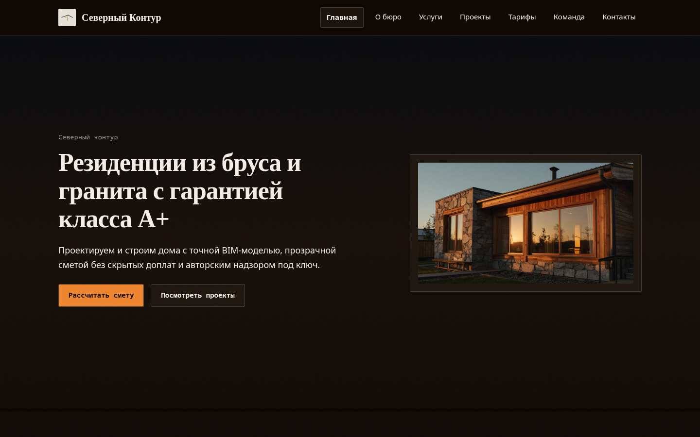
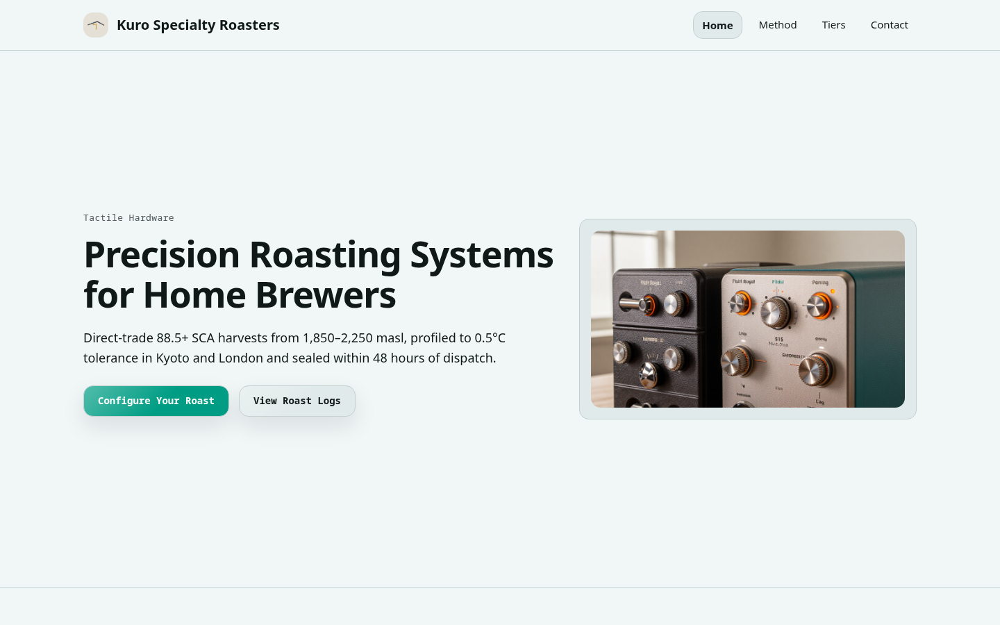
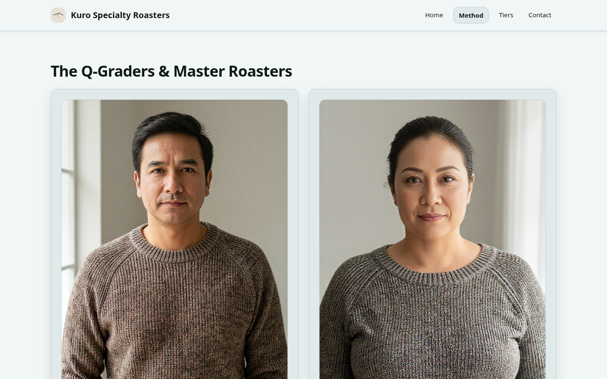

<p align="center">
  
</p>

# SmartLLM Studio `v0.0.1-beta`

<p align="center">
  <b>Local Offline Multimodal Website, Design &amp; Copywriting Atelier (EN + RU)</b><br>
  <b>English</b> | <a href="README.ru.md">Русский</a>
</p>

<p align="center">
  
  
  
   Apache-2.0">
</p>

<p align="center">
  
</p>

## 1. Visual Output Showcase (`6.0/6` Verified Builds)

<table>
  <tr>
    <td align="center" width="50%">
      <br>
      <sub><b>01 · Aether Compute</b> (Auto · EN · <code>Bento Grid</code>) — <a href="examples/01_auto_en_aether_compute.md">Prompt</a></sub>
    </td>
    <td align="center" width="50%">
      <br>
      <sub><b>02 · Северный Контур</b> (Auto · RU · <code>Visual Storytelling</code>) — <a href="examples/02_auto_ru_sever_arch.md">Prompt</a></sub>
    </td>
  </tr>
  <tr>
    <td align="center" width="50%">
      <br>
      <sub><b>03 · Kuro Specialty Roasters</b> (Constructor · EN · <code>Micro-Interactions</code>) — <a href="examples/03_ctor_en_kuro_roasters.md">Guide</a></sub>
    </td>
    <td align="center" width="50%">
      <br>
      <sub><b>3:4 Team Portraits (<code>576×768</code>)</b> — Gender-locked prompts &amp; vertical headroom framing.</sub>
    </td>
  </tr>
</table>

## 2. Overview & Verified Architecture

**SmartLLM Studio (`v0.0.1-beta`)** is a standalone, cross-platform (**Linux + Windows 11**) local multimodal website & design atelier bound strictly to `127.0.0.1:8090` with zero cloud calls, a persistent Live Stage (`1440 / 834 / 390`), and a lock-aware sequential GPU controller (`llama.cpp` ↔ `stable-diffusion.cpp` `Z-Image`).

- **3-Pane Atelier Shell:** 56 px top bar (`Constructor | Automatic Mode`, `EN | RU`, `Support`, `Settings`, `Live Stage`), 264 px step & task queue navigator, fluid centre workspace, 44% persistent right Live Stage, and 32 px Telemetry HUD (`Engine`, `VRAM`, `RAM Avail`, `Speed`, `Lock`).
- **Offline Gate Metrics:** **`227/227`** interactive DOM controls bound (`0` unbound), `0` console/page errors, `0` external network requests, **Lighthouse Accessibility `100` / Best Practices `100`**, `EN + RU` parity (`0` unexpected Latin in RU), `54` responsive shots validated.
- **Bundled Typography & Artwork:** Self-hosted Latin+Cyrillic OFL-1.1 `.woff2` typefaces (`Cormorant Garamond`, `Onest`, `JetBrains Mono`) and bundled `.avif`/`.webp` studio artworks.

## 3. Modes & Functional Contract

### Automatic Mode (Sequential Sub-Agent Pipeline)
Single-prompt site generation driven by `ProjectOrchestrator` (`smartllm_studio/pipeline.py`, `PIPELINE_VERSION = 10`): persistent project memory (`smartllm.md` + `.smartllm/state.json` + `.smartllm/memory/*.json` with SHA-256 fingerprint resume) -> `foundation` (single truth for brand, contacts, products/prices, history, canonical `team`, `features`, `stats`, `process`) -> `architect` (page quests + gallery scenes) -> `structure` -> `hero` -> `copy` + single-truth sync -> `seo` -> `visuals` (`brand-logo.png`, layout-matched heroes/gallery & `3:4` headroom `team` portraits with gender lock) -> `localize` (RU+EN switcher) -> `review` (`6/6` audit) -> sequential `sd-cli` GPU render (`resolve_slot_dimensions`) -> deterministic compiler (`canon_dossiers.json`, `read_png_dimensions`, `2×2` grid balance, SHA-256 CSP, `JSON-LD` `@graph`, `llms.txt`, `_headers`).

### 5-Step Constructor Mode
1. **Project Folder & Languages:** Pick or create `output_dir` and target output language (`EN`, `RU`, or bilingual `EN+RU` with live switcher).
2. **Brand Name & 6× Logo Generator (`512×512`):** Brand name, brief, and plain-language logo prompt (`RU`/`EN`) expanded under the `2026 Z-Image` logo canon into 6 GPU compositions, or upload an XSS-sanitized SVG/PNG/WebP logo.
3. **Design Canons Gallery:** Choose from `20` classical design canons backed by OKLCH palettes, typography roles, motion/micro-interaction dossiers (`canon_dossiers.json`), and RU/EN search.
4. **Pages & Section Blocks:** Single-page or multi-page structure across `10` corporate preset pages (`index`, `about`, `services`, `portfolio`, `pricing`, `blog`, `team`, `faq`, `contact`, `legal`) + custom pages and `19` composable section blocks (including `legal`).
5. **Company Truth, AI Block Autofill & Build:** Editable company foundation, per-page `slug::block` copy with GPU AI autofill, Z-Image visual render toggle, and `.zip`/folder export.

## 4. Quickstart (Linux & Windows 11)

### Linux
```bash
cd studio
./install.sh
./bin/smartllm-studio
```

### Windows 11
```powershell
cd studio
powershell -ExecutionPolicy Bypass -File .\install.ps1
.\smartllm-studio.bat
```

Open `http://127.0.0.1:8090` and check **Settings** to configure your local `SmartLLM-v2-K320-V1.gguf`, `llama-server`, and `sd-cli` (`Z-Image`) paths. Try ready prompts in [`examples/`](examples/).

## 5. Licensing & Weight Boundary

- **Studio Software (`studio/`):** Source-available (**`FSL-1.1-ALv2` → `Apache-2.0` after 2 years**; see [`LICENSE.md`](LICENSE.md)). Free for personal, agency, commercial, and client website work; reselling, white-labeling, or commercial SaaS hosting of Studio is forbidden.
- **Trademarks & Generated Outputs:** See [`TRADEMARKS.md`](TRADEMARKS.md) (forks must rebrand) and [`OUTPUTS.md`](OUTPUTS.md) (Licensor claims zero rights in websites, code, copy, or images you generate).
- **Third-Party Notices & Separate Weights:** See [`THIRD_PARTY_NOTICES.md`](THIRD_PARTY_NOTICES.md). Studio never bundles model weights or inference binaries (`SmartLLM v2` GGUF ships separately under `qwen-community-1.0`; `llama.cpp` and `stable-diffusion.cpp` are MIT).
- **Support Policy:** SmartLLM Studio is free. If this project saved you time, consider supporting its development — `$0` is fine. See [`DONATE.md`](DONATE.md).

Questions, or something here that looks wrong: **hello@vkvstudio.com**.
