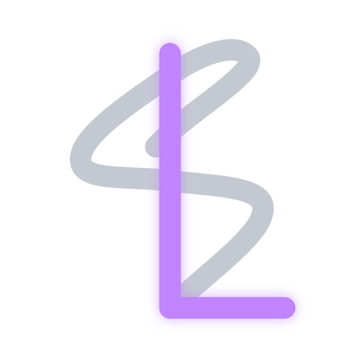
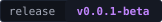
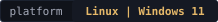
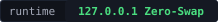
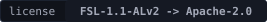
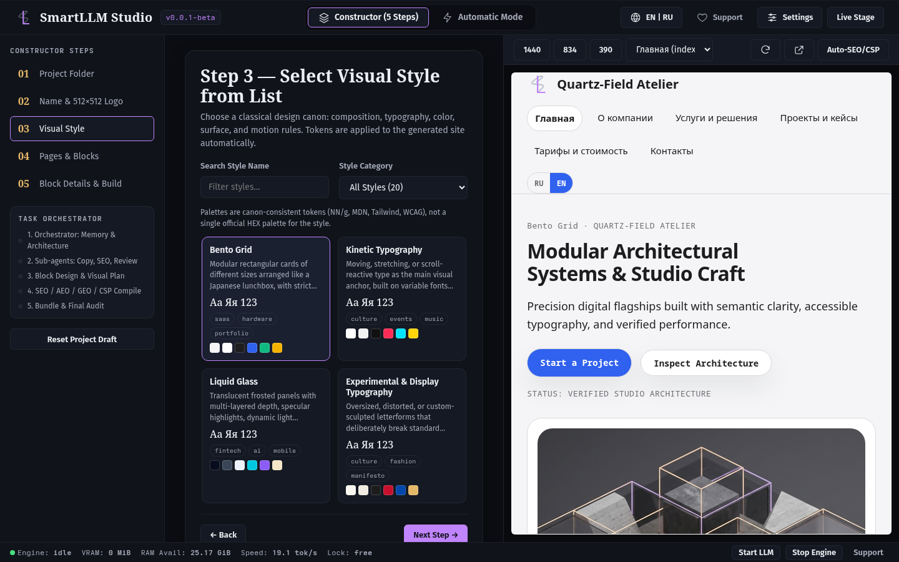
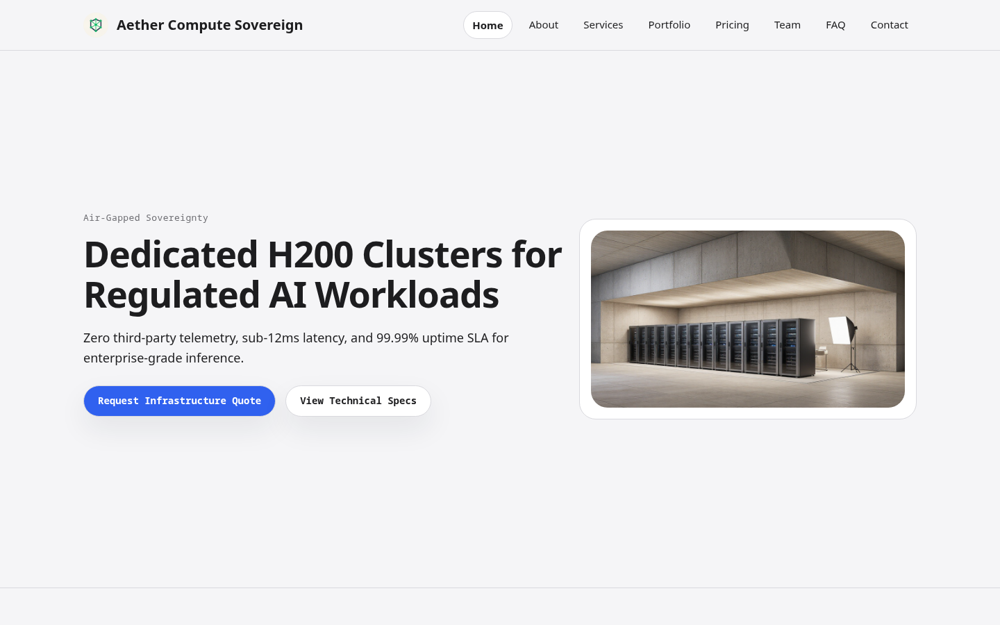
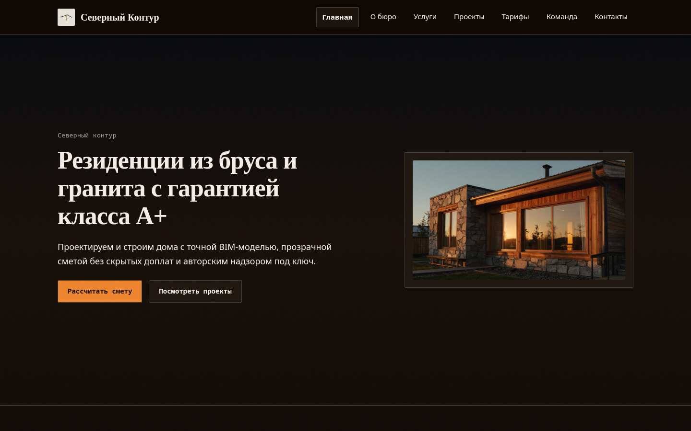
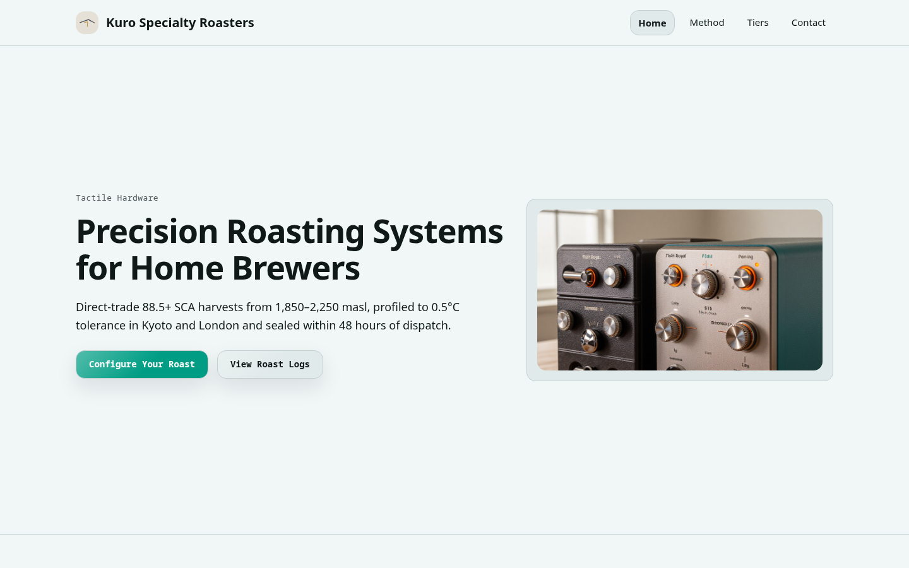
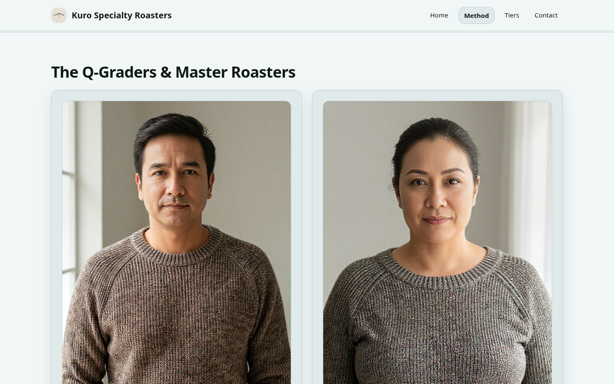

<p align="center">
  
</p>

# SmartLLM Studio `v0.0.1-beta`

<p align="center">
  <b>Локальное офлайн-ателье веб-разработки, дизайна и копирайтинга (EN + RU)</b><br>
  <a href="README.md">English</a> | <b>Русский</b>
</p>

<p align="center">
  
  
  
   Apache-2.0">
</p>

<p align="center">
  
</p>

## 1. Примеры готовых сайтов (`6.0/6` по ревизии)

<table>
  <tr>
    <td align="center" width="50%">
      <br>
      <sub><b>01 · Aether Compute</b> (Авто · EN · <code>Bento Grid</code>) — <a href="examples/01_auto_en_aether_compute.md">Промпт</a></sub>
    </td>
    <td align="center" width="50%">
      <br>
      <sub><b>02 · Северный Контур</b> (Авто · RU · <code>Визуальный сторителлинг</code>) — <a href="examples/02_auto_ru_sever_arch.md">Промпт</a></sub>
    </td>
  </tr>
  <tr>
    <td align="center" width="50%">
      <br>
      <sub><b>03 · Kuro Specialty Roasters</b> (Конструктор · EN · <code>Микровзаимодействия</code>) — <a href="examples/03_ctor_en_kuro_roasters.md">Гайд</a></sub>
    </td>
    <td align="center" width="50%">
      <br>
      <sub><b>Портреты команды 3:4 (<code>576×768</code>)</b> — привязка пола по имени и запас воздуха над головой.</sub>
    </td>
  </tr>
</table>

## 2. Обзор и подтверждённые метрики

**SmartLLM Studio (`v0.0.1-beta`)** — автономное кроссплатформенное (**Linux + Windows 11**) локальное ателье веб-разработки и дизайна на `127.0.0.1:8090` без облачных вызовов, с постоянным окном предпросмотра Live Stage (`1440 / 834 / 390`) и последовательным контроллером GPU (`llama.cpp` ↔ `stable-diffusion.cpp` `Z-Image`).

- **Трёхпанельный интерфейс:** верхняя панель 56 px (`Конструктор | Автоматический режим`, `EN | RU`, `Поддержка`, `Настройки`, `Предпросмотр`), левый навигатор шагов и очереди задач 264 px, центральная рабочая область, правый Live Stage (44%) и нижний HUD телеметрии (`Engine`, `VRAM`, `RAM Avail`, `Speed`, `Lock`).
- **Проверенные тесты интерфейса:** привязаны **`227/227`** элементов управления (`0` неактивных), `0` ошибок консоли и страницы, `0` внешних сетевых запросов, **Lighthouse Accessibility `100` / Best Practices `100`**, `0` лишней латиницы в RU-режиме, проверено `54` адаптивных скриншота.
- **Встроенная офлайн-типографика и графика:** локальные шрифты `.woff2` (`Cormorant Garamond`, `Onest`, `JetBrains Mono`) и иллюстрации `.avif`/`.webp`.

## 3. Режимы работы

### Автоматический режим (конвейер субагентов)
Генерация многостраничного сайта по одному промпту через `ProjectOrchestrator` (`smartllm_studio/pipeline.py`, `PIPELINE_VERSION = 10`): дисковая память (`smartllm.md` + `.smartllm/state.json` + `.smartllm/memory/*.json` с возобновлением по SHA-256 `fingerprint`) → `foundation` (единый источник истины) → `architect` → `structure` → `hero` → `copy` + синхронизация фактов → `seo` → `visuals` (`brand-logo.png`, обложки и галерея в пропорциях макета и вертикальные `3:4` портреты команды с запасом сверху) → `localize` (RU+EN) → `review` (`6/6`) → пакетный рендер `sd-cli` (`resolve_slot_dimensions`) → детерминированный компилятор (`canon_dossiers.json`, `read_png_dimensions`, сетки `2×2`, SHA-256 CSP, `JSON-LD`, `llms.txt`, `_headers`).

### 5-шаговый конструктор
1. **Папка проекта и язык:** выбор `output_dir` на диске и языка (`RU`, `EN` или двуязычный `RU + EN` с переключателем).
2. **Название бренда и 6 логотипов `512×512`:** описание и текстовый промпт логотипа, который `SmartLLM-v2` расширяет по канону `Z-Image 2026` в 6 композиций `512×512`, либо загрузка SVG/PNG/WebP с XSS-очисткой.
3. **Галерея дизайн-канонов:** `20` классических канонов дизайна с OKLCH-палитрами, досье анимаций и фактур (`canon_dossiers.json`) и поиском на RU/EN.
4. **Страницы и блоки:** одностраничник или многостраничник на базе `10` типовых страниц (`index`, `about`, `services`, `portfolio`, `pricing`, `blog`, `team`, `faq`, `contact`, `legal`) + свои страницы и `19` блоков (включая `legal`).
5. **Бренд-основа, ИИ-автозаполнение и сборка:** реквизиты, контакты, поблочные описания `slug::block` с ИИ-автозаполнением на GPU, рендер Z-Image и экспорт в папку или `.zip`.

## 4. Быстрый старт (Linux и Windows 11)

### Linux
```bash
cd studio
./install.sh
./bin/smartllm-studio
```

### Windows 11
```powershell
cd studio
powershell -ExecutionPolicy Bypass -File .\install.ps1
.\smartllm-studio.bat
```

Открой `http://127.0.0.1:8090`, в **Настройках** укажи пути к локальным `SmartLLM-v2-K320-V1.gguf`, `llama-server` и `sd-cli` (`Z-Image`). Готовые промпты для старта лежат в [`examples/`](examples/).

## 5. Лицензирование и граница весов моделей

1. Код SmartLLM Studio распространяется как source-available по лицензии **`FSL-1.1-ALv2`** с переходом в **Apache-2.0 через 2 года** ([`LICENSE.md`](LICENSE.md)).
2. Бесплатна для личной и коммерческой разработки сайтов для клиентов; запрещена перепродажа или платный SaaS-хостинг самой Studio.
3. Товарные знаки защищены в [`TRADEMARKS.md`](TRADEMARKS.md); по [`OUTPUTS.md`](OUTPUTS.md) все права на созданные сайты, тексты, код и изображения принадлежат вам.
4. Веса моделей и бинарные движки не входят в пакет ([`THIRD_PARTY_NOTICES.md`](THIRD_PARTY_NOTICES.md)): GGUF-веса `SmartLLM v2` распространяются отдельно по `qwen-community-1.0`. SmartLLM Studio бесплатна — поддержать разработку (можно и `0 ₽`) можно через [`DONATE.md`](DONATE.md).

Вопросы или заметили неточность: **hello@vkvstudio.com**.
